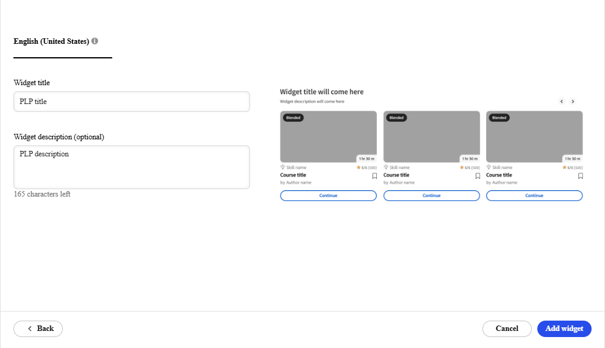

# 管理员品牌推广：重新定位主页PLP和VC条

## 在Adobe Learning Manager中添加和重新排序主页条

将个性化学习路径和虚拟指导条添加到学习者主页，拖放条以设置学习者看到的顺序。

作为管理员，您可以将个性化学习路径(PLP)和虚拟指导条添加到Adobe Learning Manager中的学习者主页。 您还可以使用&#x200B;**管理品牌**&#x200B;中的拖放控件对每个主页条带重新排序。 您现在可以决定学习者首先看到哪些条带。

您还可以将个性化学习路径小组件添加到自定义页面。

### 关于主页套餐

主页条带是显示在学习者主页上的小组件（信息卡）。 在管理员品牌推广中，您可以控制显示哪些条以及条的显示顺序。 在ALM 2026年12月版中，提供了两个AI驱动套件：

* **个性化学习路径条：**&#x200B;重点为每个学习者AI生成的学习路径。
* **虚拟辅导窗格：**&#x200B;帮助学习者从主页查找和打开辅导体验。

### 个性化学习路径条

学习者可以使用信息条执行以下操作：

* 访问AI生成的学习路径。
* 继续之前生成的学习路径。
* 发现推荐的学习旅程。

### 虚拟引导条

学习者可以使用信息条执行以下操作：

* 发现虚拟指导体验。
* 恢复辅导活动。
* 从主页开始对话AI辅导。

### 对主页条带重新排序

您可以将任何条带放在任何位置。 例如，您可以先显示虚拟指导条带，然后显示个性化学习路径、**推荐**&#x200B;和&#x200B;**目录**&#x200B;条带，再显示&#x200B;**最近查看**。

1. 在管理员应用程序中，选择左侧导航窗格中的&#x200B;**配置** > **品牌推广**。

   

2. 选择&#x200B;**学习者主页**。
3. 在条带列表中，找到要移动的条带。
4. 将条带拖到其新位置。

   

5. 保存更改。

发布后，新订单会显示在学习者主页上。

>[!NOTE]
>
>如果个性化学习路径或虚拟指导条不在列表中，请确保在重新排序之前将其添加到主页配置。

## 将个性化学习路径小组件添加到自定义页面

您可以在主页外部使用个性化学习路径构件。 将其添加到自定义页面，为学习者提供用于查找个性化学习建议的专用位置。

1. 选择&#x200B;**自定义页面**。
2. 创建页面或编辑现有页面。
3. 添加&#x200B;**个性化学习路径**&#x200B;小组件。

   

   查看小组件。

   

4. 选择&#x200B;**“继续”**。
5. 添加小组件标题和描述。

   

6. 选择&#x200B;**添加小组件**。
7. 保存页面。
8. Publish页面。
