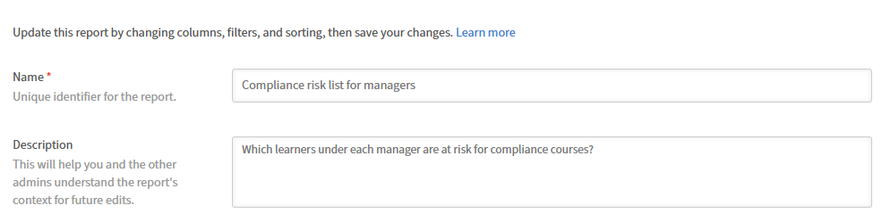
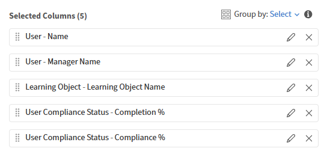
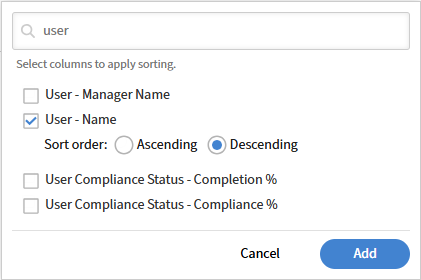

# 在Report Builder中构建自定义报告

## 概述

当您清楚了解所需的列和输出且现有模板与您的用例不匹配时，从头开始创建可获得最佳效果。 如果您是Report Builder新手，请考虑从模板开始。

## 生成自定义报告

在本例中，您将在每个经理下找到存在合规性课程风险的学习者。

1. 以管理员身份登录Adobe Learning Manager。
2. 选择&#x200B;**报表**，然后选择&#x200B;**Report Builder**。
3. 选择“**报表**”选项卡，然后选择“**创建报表**”。
4. 输入报告名称。 需要名称。 （可选）输入说明。

   

5. 在“列”面板中，选择并展开以下数据集：

   * 用户
   * 学习对象
   * 用户符合性状态

6. 在要包含的以下列旁选择&#x200B;**+**。 选定列将显示在报告画布中。

   * User-Name
   * 用户 — 经理姓名
   * 学习对象 — 学习对象名称
   * 用户符合性状态 — 完成%
   * 用户符合性状态 — 符合性%

   

7. 通过在画布中拖动列来重新排列顺序。
8. 要重命名列，请在列的&#x200B;**别名**&#x200B;字段中输入名称。 如果指定一个别名，则该别名用作列标题。 如果不指定别名，则默认列标题包含数据集名称。 例如，“学习对象”数据集中的“名称”显示为“学习对象 — 名称”。

   **列标题**

   Report Builder在默认列标题中包括数据集名称，以帮助区分不同数据集中具有相似名称的列。 例如，如果您从学习对象数据集中选择“名称”，则列标题将显示为“学习对象 — 名称”。

   如果为列指定自定义别名，则Report Builder使用别名，而不是默认的列标题。

   **对现有报告的影响**

   升级后，使用默认列名且没有自定义别名的现有报表将显示更新的列标题。 例如，“学习对象”数据集中的“名称”会从“名称”更改为“学习对象 — 名称”。

   报告数据、筛选器和计划不受影响。

   如果在通过标题引用列的脚本、电子表格、BI仪表板或集成中使用报表输出，请检查下游系统，并根据需要更新对上一列标题的引用。

   要保留特定列标题，请为列设置自定义别名。

9. 选择&#x200B;**保存报告**。

## 下载报告

1. 选择右上角的&#x200B;**操作**。

   

2. 选择&#x200B;**下载**。 报告准备好后，您可以通过通知图标进行下载。

下载的报告(csv)包含以下列：

* name
* managerName
* name
* completionPct
* compliancePct

## 应用分组依据、筛选器和排序

### 过滤器

现在您已下载报告，请应用completionPct OR compliancePct等于100的过滤器。

1. 打开报告并选择右上角的&#x200B;**编辑**。
2. 选择&#x200B;**添加筛选器**&#x200B;并搜索要应用筛选器的列。

   

3. 选择&#x200B;**添加**。
4. 将筛选器与AND/OR逻辑组合；选择在筛选器行之间切换运算符。

   

5. 选择&#x200B;**保存报告**&#x200B;并下载报告。

下载的报告包含completionPct OR compliancePct等于100的记录。

### 分组依据

按经理将记录分组到：

* 按经理聚合学习者数据
* 计算管理器级别平均值
* 按每个经理对学习者进行计数

1. 打开报告并选择右上角的&#x200B;**编辑**。
2. 选择&#x200B;**“分组依据”:Select**，然后选择&#x200B;**“用户管理器名称”**&#x200B;列。

   

3. 聚合以下列：

   * 用户名
   * 学习对象 — 学习对象名称

4. 选择&#x200B;**Count**&#x200B;作为列的聚合函数。

   

   **聚合列的列标题：**

   在应用聚合函数时，默认的列标题包括聚合函数。 例如，当您将&#x200B;**Count**&#x200B;应用于&#x200B;**学习对象 — ID**&#x200B;时，列标题显示为第&#x200B;**Count**&#x200B;个，共&#x200B;**学习对象 — ID**&#x200B;个。 如果已指定自定义别名，则该别名将保持不变。

5. 对“学习对象” — “学习对象名称”重复此操作。

   

6. 选择&#x200B;**保存报告**&#x200B;并下载报告。

下载的报告包含经理对学习者培训绩效的摘要。 它显示了每个经理的平均完成率、平均相容性分数和总学习者计数。 数据显示，所有小组都完成了通用培训，而管理人员之间的合规性绩效差异很大。

### 排序

按每个经理的学习者人数对报告进行降序排序。

1. 打开报告并选择右上角的&#x200B;**编辑**。
2. 选择&#x200B;**添加排序**。
3. 搜索用户名并选择&#x200B;**用户名**。
4. 选择&#x200B;**降序**。

   

5. 选择&#x200B;**添加**。
6. 选择&#x200B;**保存报告**&#x200B;并下载报告。

下载的报告包含每位经理的学习者数量，并以降序排列。
