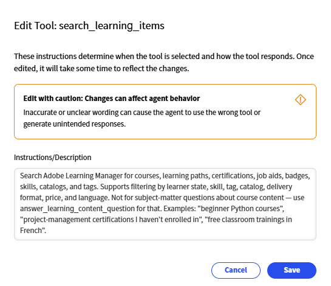

# 配置模型上下文协议服务器

## 概述

每个MCP服务器都会注册一个OAuth 2.0客户端应用程序，该应用程序授权AI客户端代表学习者进行操作。 作为管理员，您创建服务器并复制其凭据，然后将这些凭据提供给AI客户端管理员，由管理员完成连接。 您可以随时重新访问服务器以对其进行编辑、细化其工具描述、复制其凭据或删除它。

>[!NOTE]
>
>服务器仅向具有学习者角色的用户提供读取权限。

## 创建MCP服务器

1. 以管理员身份登录Adobe Learning Manager 。
2. 导航到&#x200B;**学习中的AI** > **MCP服务器**。
3. 选择&#x200B;**新建MCP服务器**。
4. 输入服务器详细信息，包括说明。

   * **服务器名称：**&#x200B;输入一个最多50个字符的名称。
   * **描述：**&#x200B;输入简短描述，最多可包含150个字符。
   * **URL：**&#x200B;输入您的公司或应用程序URL。
   * **重定向域：**&#x200B;输入要连接的每个AI客户端的域，如[http://\*.chatgpt.com](https://encoded-592c9deb-987b-4562-aa3c-9fa3d37d83e9.uri/http%3a%2f%2f*.chatgpt.com)或[http://\*.claude.ai](https://encoded-592c9deb-987b-4562-aa3c-9fa3d37d83e9.uri/http%3a%2f%2f*.claude.ai)。 该字段为必填项。

   

5. 选择&#x200B;**下一步**。
6. 在&#x200B;**可用工具**&#x200B;页面上，查看服务器公开的学习者工具。 为MCP工具提供详细、上下文和基于目的的说明。提供每个工具的详细上下文描述。 精确的描述有助于与MCP兼容的客户端选择和调用适当的工具。 包括工具用途、支持任务、预期输入和典型用例。

   

   为每个工具选择“**视图**”以查看相关说明，以确定何时选择该工具以及该工具的响应方式。

   

7. 在左侧导航窗格中选择&#x200B;**客户端凭据**。
8. 复制&#x200B;**MCP终结点URL**、**客户端ID**&#x200B;和&#x200B;**密钥**。 在每个值旁选择&#x200B;**复制**。

   

9. 选择&#x200B;**关闭**。

>[!NOTE]
>
>服务器仅向具有学习者角色的用户提供读取权限。

将端点URL、客户端ID和密钥提供给AI客户端管理员。

## 编辑工具描述

工具描述会告知AI客户端何时选择工具以及该工具的响应方式。 您还可以添加示例提示。 编写完善的工具描述可帮助MCP兼容的客户端更准确地发现并调用适当的工具。 包括工具用途、支持的任务、预期的输入和典型用例。

1. 在&#x200B;**可用工具**&#x200B;页面上，为工具选择&#x200B;**操作**&#x200B;菜单。
2. 选择&#x200B;**MCP工具配置** \> **编辑**。

   

3. 在&#x200B;**编辑工具**&#x200B;对话框中，更新&#x200B;**说明/描述**。

   

4. 在&#x200B;**示例提示**&#x200B;下，编辑提示。 要添加提示，请选择&#x200B;**添加另一个示例**。
5. 选择&#x200B;**“保存”**。

要将工具恢复为其原始措辞，请选择该工具的&#x200B;**操作**&#x200B;菜单，然后选择&#x200B;**MCP工具配置** \> **重置**。

## 编辑MCP服务器

1. 选择&#x200B;**学习中的AI** > **MCP服务器**。
2. 选择服务器名称。
3. 选择&#x200B;**“编辑”**。
4. 更新&#x200B;**应用程序详细信息**&#x200B;页面上的字段，然后保存更改。

## 删除MCP服务器

1. 选择&#x200B;**学习中的AI** > **MCP服务器**。
2. 在服务器的行中，选择&#x200B;**操作**&#x200B;菜单。
3. 选择&#x200B;**删除**。
4. 在确认对话框中，选择&#x200B;**删除**。

>[!WARNING]
>
>删除服务器会删除所连接的AI应用程序对其所有工具的访问权限。 活动会话可能会立即停止工作，并且您无法撤消删除操作。

## 故障排除

**工具更改不会立即显示。**
对工具描述的编辑需要一些时间才能生效。 等待并重试。

**删除服务器后，AI客户端停止工作。**
创建新服务器，并将新凭据提供给AI客户端管理员。

**AI客户端使用了错误的工具。**
查看您更改的所有工具说明。 选择“**重置**”以恢复原始措辞。

## 最佳实践

* 保留原始工具描述，除非您出于特定原因需要更改它们。
* 在编辑时编写具体的、明确的工具说明和示例提示。
* 安全地存储密钥，并仅与您的AI客户端管理员共享它。
* 为每个AI应用程序创建一个单独的服务器，以便您可以撤销一个服务器而不会影响其他服务器。
* 在删除服务器之前，请确认没有任何AI应用程序依赖于该服务器。
