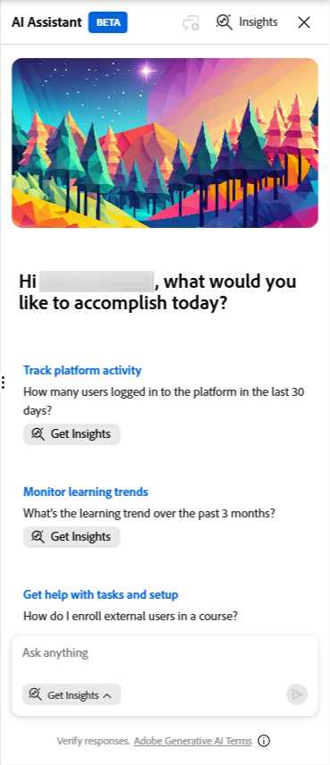
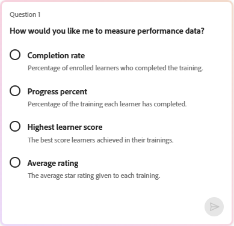
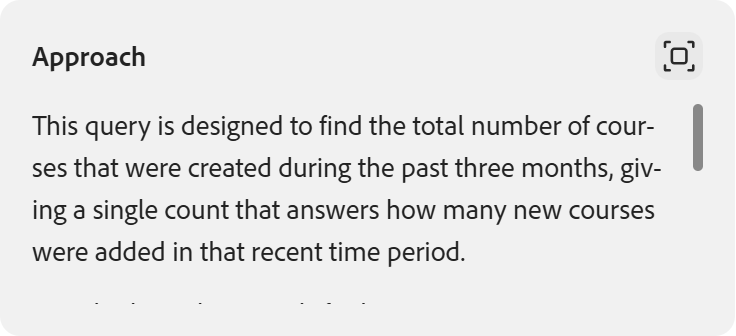
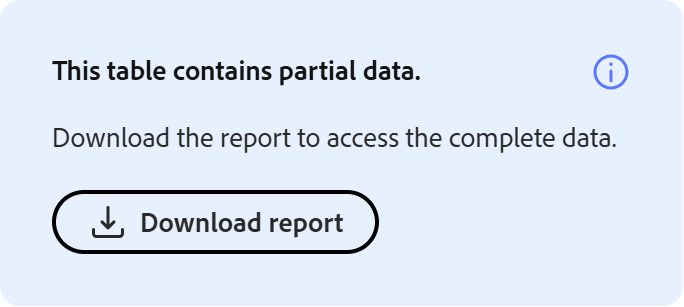
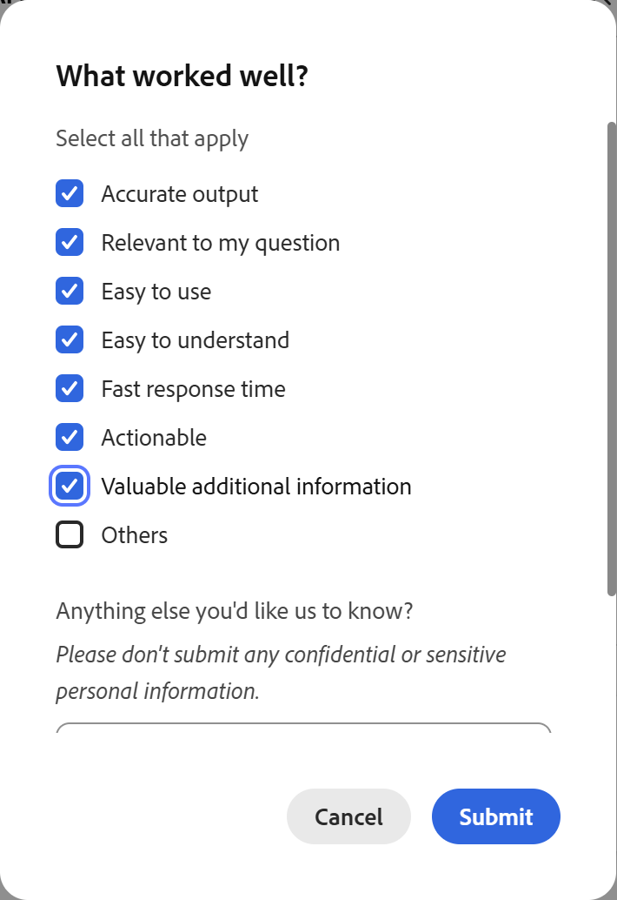
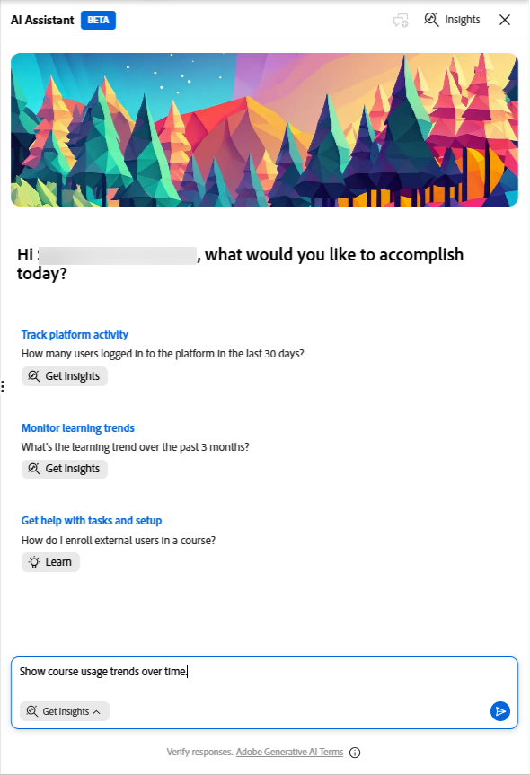
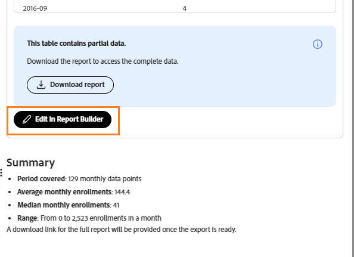
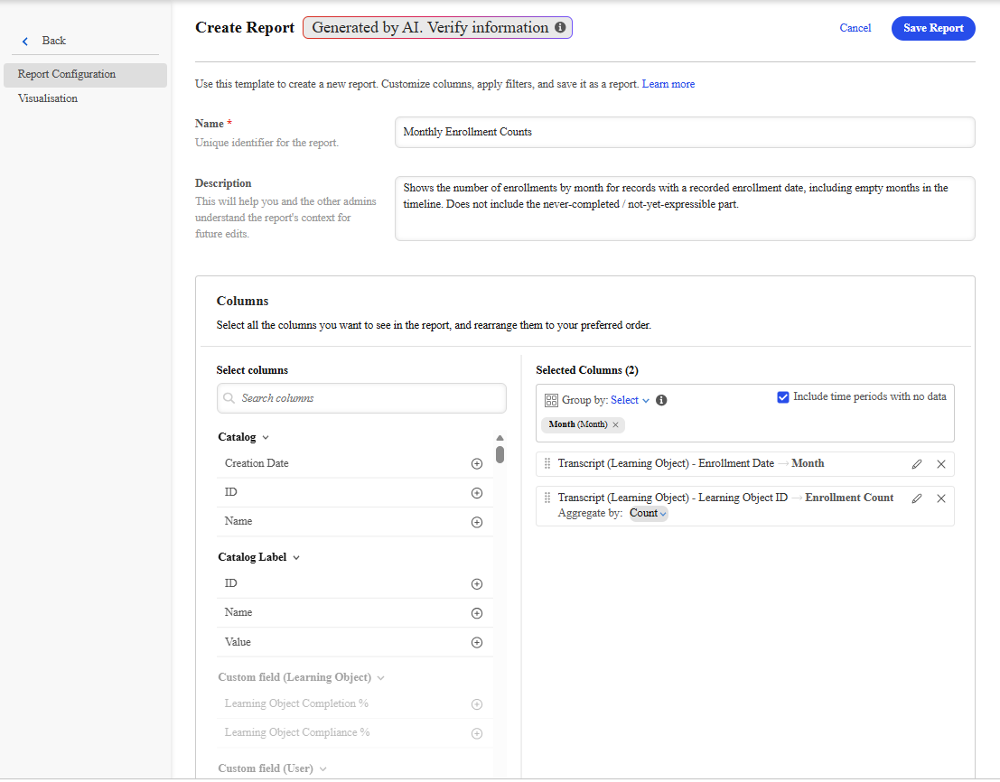

# 什么是Insights代理？

Insights代理是Adobe Learning Manager中一项由AI支持的功能，管理员可使用自然语言查询学习数据。 无需下载报告和处理电子表格，只需键入一个问题，如“过去3个月在帐户中创建了多少课程？ 提供月度报告。”，Insights客服专员将直接检索并显示数据。 您可以用文本、项目符号或表格式查看结果，也可以用CSV文件格式下载结果。

Insights Agent旨在减少从提出数据问题到获得答案的步骤。 当前依赖Excel数据透视、BI团队或多个组合报告的管理员可以使用Insights代理更快地获得答案。

## Insights客服专员可以做些什么

您可以使用Insights代理执行以下操作：

* 按区域、部门或用户组检查完成情况和合规性指标
* 分析课程或学习路径的注册趋势
* 查看特定课程或学习路径的进度数据

每个查询都会返回一个格式化表或可下载的CSV文件，以及关于如何计算结果的浅显语言说明。

## Data Insights代理不支持的功能

以下数据类型当前不在Insights代理的范围之内：

* 反馈和调查数据
* 游戏点数和徽章
* 审核历史记录和更改日志

引用这些数据类型的查询将不会返回结果。 例如，“上一季度奖励了多少个游戏点数？” 或“哪些学习者已获得合规性徽章？” 将返回错误或不完整的数据。

## Insights代理的工作原理

当您输入问题时，Insights客服专员会分四个阶段处理它：

1. **解释**：代理会分析您的问题以确定需要什么数据。 如果问题的任何部分不明确，客服专员在继续操作之前会向您询问澄清问题

2. **方法**：代理描述了查找您的答案的步骤。 本节帮助您验证数据是否按预期方式检索，特别是对于复杂查询。

3. **结果**：代理根据结果的性质，以文本、项目符号或表格形式呈现您的数据。 结果中包含简单明了的摘要。 当结果包含50行或更少行时，摘要将包含有关数据的分析见解。 当结果包含50行以上时，摘要将提供列级统计信息。

4. **下载**：您可以将结果下载为CSV文件。 大型报告可能需要额外的时间；代理会在文件准备就绪时通知您。

**方法**&#x200B;部分对于复杂查询特别有用。 它显示了客服专员使用的逻辑，类似于BI分析师在手动运行查询时解释的逻辑。 查看该方法有助于在操作之前确认输出是否可靠。

## 使用Insights代理提出问题

使用Adobe Learning Manager中的Insights代理查询包含纯语言问题的学习数据，并以文本、表格或可下载CSV文件的形式获得结果。

管理员可从Learning Manager的AI Assistant面板中使用见解代理。 面板可以调整大小。 您可以对其进行扩展，以便更易于阅读。 默认情况下，当您打开面板时，将选择&#x200B;**获取Insights**&#x200B;模式。 另外，还提供了一个单独的&#x200B;**学习**&#x200B;模式用于回答有关如何使用该产品的指导性问题。 **学习**&#x200B;模式回答有关如何使用Learning Manager的指导性问题。 例如，“如何创建学习路径？” 它不查询学习者数据。

### 提出问题

默认选择&#x200B;**获取Insights**&#x200B;模式后，您可以立即开始查询学习数据，无需在每次访问助理时调整模式。 但是，如果您切换到&#x200B;**学习**&#x200B;模式来提出指导性问题，请确保在提交查询之前重新选择&#x200B;**获取Insights**。

1. 选择Learning Manager中的AI Assistant图标以打开“助理”面板。 默认情况下，**获取Insights**&#x200B;选项已处于选中状态。

   

2. 在文本字段中输入问题。 使用纯语言。 例如： **过去3个月创建了多少门课程？**

3. 选择&#x200B;**发送**&#x200B;或按&#x200B;**Enter**&#x200B;以提交您的问题。

### 查看回复

提交您的问题后，Insights客服专员会处理您的请求，并返回最多包含四个部分的答复：

1. **消除歧义（如果需要）：**&#x200B;如果您的问题包含不明确的术语，例如“学习活动”、“绩效”或“提供过去三个月的绩效数据”，则助理会显示选项列表，并要求您选择一个选项后再继续操作。 选择与您要查找的内容最匹配的选项。 在最初的问题之后，您无法键入其他说明。 在使用查询界面启动新查询之前，从提供的选项中选择是唯一可用的交互。 您只能通过从提供的选项中进行选择来响应消除歧义；此版本中未提供自由文本跟进。

   

2. **方法：** **方法**&#x200B;部分介绍了代理检索数据时采取的步骤。 该面板在问题下方显示为可滚动面板。 选择“展开”图标以查看完整方法。 查看本节可帮助您确认逻辑是否与您的意图相匹配，特别是对于复杂查询。 例如，如果您要求“去年注册的所有学习者”，客服专员可能会返回每个学习者最近的注册，而不是每个注册记录。 **方法**&#x200B;部分说明了代理在检索数据时做出的决定。 如果逻辑与您的意图不符，请使用更具体的术语开始新查询。

   

3. **结果：** Insights代理以文本或表形式生成结果。 对于最好以表格格式解释的数据点，Insights代理会返回一个表。 Insights代理不生成图表或图形。 要可视化数据，请下载CSV并在您首选的工具中将其打开。 结果中包含简单明了的摘要。 当结果包含50行或更少行时，摘要将包含有关数据的分析见解。 当结果包含50行以上时，摘要将提供列级统计信息。 例如，“哪些课程的注册人数不少于过去1年创建的5名，哪些课程是作者？”

   

响应包含以下摘要：

***摘要***

- *匹配的课程：102*
- *注册计数范围：24到2019*
- *每个匹配课程的平均注册数：589.6*
- *每个匹配课程的中值注册数：553.5*

*导出准备就绪后，将提供完整报告的下载链接。*

>[!NOTE]
>
>摘要的格式因数据的性质而异。 以下是摘要响应的一个示例。 实际摘要将因查询而异。

>[!NOTE]
>
>Insights Agent是概率代理。 如果同一查询运行两次，则响应短语或结果排序可能会略有不同。

### 下载报告

选择&#x200B;**下载报告**&#x200B;以将结果导出为CSV文件。 对于大型结果集，下载可能需要额外的时间。 当文件准备就绪时，代理会显示一条消息；您也会收到通知。

## 启动新查询

每个Insights客服专员会话一次只能处理一个问题。 在查看结果后，选择&#x200B;**新问题**&#x200B;以询问其他问题。 如果想放弃当前查询并重新开始，还可以随时选择&#x200B;**新建聊天**，包括在收到响应之前。 您不能在同一会话中键入跟进问题，也不能让客服专员根据返回的结果进行优化或展开。

>[!TIP]
>
>如果要浏览相关数据，请启动一个新的查询，其中包含您从第一个查询中学到的内容。 例如，在查看按区域列出的登记合计之后，开始一个新查询，以深入了解表现不佳的区域。

## 提出反馈

每次响应后，选择拇指向上或拇指向下图标对结果进行评分。 您还可以指定输出是否不准确、难以理解或返回所用时间过长。 此反馈有助于逐渐改善客服专员。

## 最佳实践

- 从一个具体的问题开始，而不是一个宽泛的问题。 “北美用户组的安全培训课程完成率是多少？” 返回比“显示完成数据”更有用的结果。
- 命名内容和学习者组时，请使用准确的Adobe Learning Manager术语。 查询编写指南列出了要使用的正确术语。
- 如果客服专员询问澄清问题，请将其作为下次优化原始查询的信号。 您的问题越具体，所需的说明就越少。
- 在操作结果以确认代理的逻辑与您的意图相符之前，请查看&#x200B;**方法**&#x200B;部分。
- **指定是否包括轮候学习者。** 默认情况下，注册计数查询仅返回具有有效、已确认的注册信息的学习者 — 根据课程或学习路径页面中提供的注册学习者列表，排除轮候学习者。 如果希望轮候学习者包含在计数中，请在查询中明确表述。 例如：“包括轮候学习者在内的多少名学习者直接注册了安全培训课程？” “方法”部分将指明结果中是否包含轮候学习者。
<!--
- **Specify whether to include or exclude waitlisted learners**. By default, enrollment count queries include learners who are on a waitlist alongside active, confirmed enrollments. If you need only active participants, explicitly exclude waitlisted learners in your query. For example: "How many learners are directly enrolled in the Safety Training course, excluding waitlisted learners?" The agent will disclose in the Approach section that the exclusion was applied. Without this instruction, enrollment totals may include a significant proportion of waitlisted learners who have not yet started the content.
-->
- **直接和间接注册计数**：当您查询课程或学习路径的注册或完成数据时，Insights代理会区分直接注册（专门注册该课程或学习路径的学习者）和间接注册（在学习路径或认证中访问相同内容的学习者）。 如果您专门要求直接或间接注册，客服专员将返回每种类型的正确计数。 如果您的查询没有直接或间接指定，客服专员可能会返回合并计数。 要获取分隔计数，请在查询中明确包含区分。 例如：“直接注册还是间接注册安全培训课程，有多少学习者？”

## Insights客服专员与Report Builder的差异

这两种功能使用相同的基础学习数据，但作用不同。 Insights客服专员可对话。 你描述你想要什么，客服专员就会拿到。 Report Builder结构化。 可以选择数据集、列和筛选器来构建可重复使用的报告。

| **用例** | **推荐** |
|---|---|
| 快速提出数据问题 | Insights代理 |
| 在不了解架构的情况下浏览数据 | Insights代理 |
| 构建结构化、可重复的报告 | Report Builder |
| 使用自定义连接合并多个数据集 | Report Builder |
| 计划报告订阅 | Report Builder |
| 将数据集与自定义联接或高级数据建模相结合 | Report Builder |

## 为Insights客服专员编写有效的查询

查询的质量直接影响Insights客服专员返回结果的质量。 格式良好的查询包括三个要素：上下文（例如）内容、学习者、范围（例如，状态、时间范围和用户状态）和列（例如，您希望在输出中显示的确切字段）。 了解如何使用正确的术语、查询结构和示例查询作为起点。

### 由三部分组成的查询公式

每个有效的Insights代理查询都包含以下三个组件：

| **组件** | **什么可能意味着** | **示例** |
|---|---|---|
| **上下文** | 您正在询问的内容和学习者 | “……位置101中面向销售助理学习者的新员工入门培训学习路径……” |
| **作用域** | 注册状态、时间范围和用户状态 | “……在过去90天内已注册但尚未完成的人员……” |
| **列** | 输出中所需的每个字段 | “……显示姓名、电子邮件、位置和注册日期” |

缺少其中任何一种成分可能导致不明确的结果或试剂的澄清问题。

### 使用正确的ALM条款

Insights代理会将您的查询与Adobe Learning Manager的数据模型匹配。 使用错误的术语可能会返回不正确或没有结果。 使用下面左栏中的术语。

| **使用此术语** | **不是** |
|---|---|
| **学习路径** | 计划/轨道/课程 |
| **课程** | 模块/课程/课程 |
| **认证** | 徽章/证书 |
| **学习者** | 学生/员工 |
| **会话** | 课程/计划日期 |
| **用户组** | 团队/部门/同类群组 |
| **活动字段** | 自定义字段/属性 |
| **注册** | 登记/转让 |
| **完成** | 已完成/完成/通过 |
| **目录标签** | 类别/标记组 |

Insights Agent不区分大小写，但精确术语匹配可提高准确性。

### 使用组织的自定义术语进行查询

如果您的管理员已使用&#x200B;**设置>常规**&#x200B;中的产品术语重命名标准术语，则Insights代理会识别您的组织的自定义术语，而不是上面列出的默认值。 例如，如果您的组织将&#x200B;**课程**&#x200B;重命名为&#x200B;**第**&#x200B;章，您可以询问“上个月完成了多少章？” 和见解代理在响应和列标题中使用&#x200B;**章**&#x200B;了解问题并标记结果。

自定义术语适用于Insights客服专员聊天窗口内的所有内容，包括查询的解释方式、方法说明、结果摘要以及聊天中显示的表格或列标题。 **下载的CSV文件未反映自定义术语。** 导出的文件中的列标题和内容使用默认的Adobe Learning Manager术语，无论您的组织如何自定义它们。

- Insights Agent能够识别自定义术语的单数和复数形式，如产品术语CSV文件中配置的那样。
- 即使在组织自定义了默认Adobe Learning Manager术语后，您仍可以在查询中使用它。 Insights客服专员识别默认词语，并使用您组织的自定义词语进行回复。 例如，如果您的组织将&#x200B;**课程**&#x200B;重命名为&#x200B;**第**&#x200B;章，您仍然可以询问“上个月完成了多少章？” 使用原始术语。 Insights客服专员能够理解问题，并在回复中使用您组织的自定义术语&#x200B;**章**&#x200B;进行回复。
- 如果您的查询包含拼写错误或无法识别的术语，Insights客服专员会提出澄清问题，并建议您的帐户中可用的最接近的匹配术语或术语。
- 如果您的管理员重置自定义术语，Insights代理将不再识别以前自定义的术语并恢复为默认术语。

>[!NOTE]
>
>自定义术语支持不扩展到Insights客服专员当前未查询的模块和选项卡，例如社交学习、工作辅助、论坛、游戏和公告。

<!--
### Query using your organization's custom terminology

If your administrator has renamed standard terms using **Product Terminology** in **Settings** > **General**, Insights Agent recognizes your organization's custom terms in place of the defaults listed above. For example, if your organization renamed **Module** to **Training**, you can ask "How many Trainings were completed last month?" and Insights Agent understands the question and labels the results using **Training** in the response and column headers.

- Insights Agent recognizes both the singular and plural forms of a custom term, as configured in the Product Terminology CSV file.
- You can still use the default Adobe Learning Manager term in your query even after your organization customizes it. Insights Agent recognizes the default term and responds using your organization's custom term.
- If your query includes a misspelled or unrecognized term, Insights Agent asks a clarifying question and suggests the closest matching term available in your account.
- If your administrator resets the custom terminology, Insights Agent no longer recognizes the previously customized terms and reverts to the default terms.

>[!NOTE]
>
>Custom terminology support does not extend to modules and tabs that Insights Agent does not currently query, such as Social Learning, Job Aids, Discussion Forum, Gamification, and Announcements.
-->

### 定位内容

提供内容锚点可帮助客服专员了解要查看哪些学习项目。 您可以通过以下任一方式定位：

| **锚点类型** | **示例** |
|---|---|
| 姓名 | “……新员工入门培训学习路径” |
| 目录 | “……入门目录中的所有学习路径” |
| 目录标签 | “……目录标签区域=北方的全部课程” |
| 标签 | “……所有已标记为‘合规性’的课程” |
| 技能 | “……所有映射到客户服务技能的课程” |
| 合规性标签 | “……所有带有合规性标签的认证” |
| 内容类型 | “……所有已发布的课程”/“……所有认证” |

### 定位学习者

如果查询与学习者相关，请使用以下方法之一：

- **活动字段值** — “活动字段职称=销售助理的学习者”或“活动字段位置= 101的学习者”
- **用户组** — “Sales Associates用户组中的学习者”
- **讲座** — “已注册6月15日工作场所安全课程的学习者”

### 定义范围

忽略范围细节可能会导致比预期更广泛的结果。

| **作用域类型** | **选项** |
|---|---|
| 注册状态 | 已注册/已完成/未注册/逾期 |
| 时间范围 | 所有时间/过去30天/过去90天/特定日期范围 |
| 用户状态 | 仅限活动用户（默认）/为非活动用户添加“包括已删除的用户” |

### 为每个输出列命名

如果您未指定列，则Insights代理会为您选择这些列。 为输出中所需的每个字段命名。

| **模糊** | **特定** |
|---|---|
| “显示库位编号” | “对于每个位置：学习者总数、已注册计数、未注册计数” |
| 显示完成率 | “对于每个学习路径：名称、已注册总数、已完成总数、完成百分比” |
| “让我看看谁失败了” | “显示失败的学习者的姓名、电子邮件、课程名称和完成状态” |

### 查询示例

使用这些作为起点。 通过替换适用于您的帐户的内容名称、用户组和时间范围来调整它们。

**完成和合规**

- “北美用户组的安全培训课程完成率是多少？”
- “显示所有合规性课程按用户组的完成率。 包括用户组名称、已注册总数、已完成总数和完成百分比。”
- “如果活动字段“职务”为“VP”，则所有学习者的合规率是多少？”

**注册分析**

- “有多少学习者按位置注册了新员工入门培训学习路径？”
- “按区域显示过去90天的注册人数。 包括区域名称和注册计数。”
- “列出所有已注册安全生产课程但尚未完成的学习者 — 包括姓名、电子邮件和注册日期。”

**计划和课程进度**

- “领导力发展学习路径的完成状态明细是什么？ 显示已完成、进行中以及未开始计数。”
- “上个月有多少学习者完成了数据隐私课程？”

**组织视图**

- “显示所有符合性类型标签认证的完成率，按部门分组。 包括部门名称、总注册人数和完成比例。”
- “过去30天按地区列出的注册分布情况如何？”

### 要避免的常见错误

| **避免** | **改为执行此操作** |
|---|---|
| 无内容锚点（“显示全部内容”） | 为特定路径、课程、目录、标签或技能命名 |
| 模糊指标（“为什么完成率低？”） | 问一个可衡量的问题：“按位置划分，哪些学习路径的完成率低于30%？” |
| 未指定用户状态 | 明确添加“仅限活动用户”或“包含已删除的用户” |
| 询问预测 | 询问当前数据显示哪些内容，而不是将发生什么 |
| 询问不支持的数据（反馈、技能、徽章） | 使用报告部分中的现有报告 |
| 在一个查询中提出多个问题（“按区域显示注册并列出未完成安全培训的人员”） | 每个查询询问一个重点问题。 客服专员只能回答复合查询的一部分，不能保证其余部分得到处理。 |

## 版本中的限制

**不支持在非拉丁语脚本中提交的查询**

Insights客服专员支持以英语和拉丁字母语言（如法语和西班牙语）编写的查询。 系统不会处理使用非拉丁语脚本（包括日语、中文、阿拉伯语、韩语、印地语和俄语）提交的查询。 客服专员将显示一条消息，指示无法完成查询。 如果您使用其中一种语言提交查询，请启动新查询并使用英语重新设置其短语。

## 从Insights客服专员答案创建报告

在Adobe Learning Manager中，您可以用浅显的语言向Insights客服专员提问，然后以Report Builder报告形式打开答案。 然后，您可以编辑报告并重复使用它，这样您就不必从头开始重新构建它。

## Insights代理与Report Builder的集成是什么

在Adobe Learning Manager中，可通过两种方式从代理和Report Builder访问同一数据。 两者运行在同一数据平台上。

* **Insights代理**&#x200B;允许您用自然语言提出问题。
* **Report Builder**&#x200B;允许您通过选择数据集、列、聚合和筛选器来构建报告。 您还可以使用它来创建定期报告、订阅报告和编辑现有报告。

集成将二者连接起来。 您从一个问题开始，查看答案，然后在Report Builder中打开。 在此处，您可以修改报告并继续使用它，就像处理任何其他报告一样。 管理员当前可使用此集成。

并非每个Insights客服专员回答都能成为报告。 只有在报告符合客服专员的回复意图和您的问题时，客服专员才能在Report Builder中打开答案。

## 集成的工作方式

当您提出问题时，Insights代理会生成数据查询并检索相应的结果。 如果查询可以平移到Report Builder构造中，则Adobe Learning Manager会根据生成的查询创建一个草稿Report Builder报告。

Insights代理：

1. 根据您的问题生成查询。
1. 将生成的查询映射到Report Builder数据集和字段。
1. 创建草稿报告。
1. 根据客服专员的回复和原始问题验证报告。
1. 以Report Builder打开报告以供审阅。

## 从Insights客服专员答案创建报告

1. 启动&#x200B;**Insights代理**。

1. 以简单语言输入您的问题。 等待答案。 Insights客服专员在后台准备报告，因此对话可以不间断地继续。

   

1. 查看Insights客服专员消除歧义和/或提供响应生成方法后生成的响应。

1. 选择&#x200B;**在Report Builder中编辑**。

   

   Report Builder将打开生成的报告和列，并在必要时自动应用group by或aggregate函数。 报告的名称和说明也会自动生成。

   >[!NOTE]
   >
   >当Insights代理未找到有关您的问题的数据时，也会显示&#x200B;**在Report Builder中编辑**&#x200B;选项。 您可以稍后创建并修改报告。 创建报告后可能会显示数据，因此报告将一直为空，直到存在匹配的数据。

   

1. 查看生成的报告。 Report Builder会将答案中的字段映射到其自己的字段，例如，课程名称和描述。 如果Insights客服专员无法转换您的部分问题，报告会在报告旁边将这些项目列为间隙。

1. 根据需要编辑报告。 例如，添加或更改列、聚合或过滤器。

1. 保存报告。 选择&#x200B;**保存报告**。

报告即会以Report Builder打开，其中包含转换后的字段和匹配数据。 现在，您可以像编辑任何其他报告一样对其进行编辑和管理。

## 编辑生成的报告

在Report Builder中打开报告后，您可以：

* 添加或删除列。
* 更新过滤器。
* 修改聚合。
* 更改排序。
* 保存报告。
* 共享报告。
* 添加可视化。
* 创建面板。

## Insights客服专员如何将答案转换为报告

Insights客服专员和Report Builder的设计方式不同。 因此，Insights代理中的答案可以包含Report Builder不能完全表示的数据。 为此，Insights客服专员会分阶段转换每个答案。

| 阶段 | 发生什么情况 |
|---|---|
| 查询 | Insights客服专员会计算用于回答您问题的查询。 Report Builder从同一查询同时开始，因此不会阻止您的对话。 |
| 字段映射 | 查询将映射到Report Builder数据集和字段。 根据该映射生成工作报告。 |
| AI草稿 | AI会起草报告并对其进行验证。 |
| 审阅 | 将对照已编制的查询和您的原始问题检查报告。 验证将同时运行。 |
| 校正 | 如果验证功能发现错误，则会自动修复这些错误。 |
| 间隙列表 | Report Builder字段无法表达的问题中的任何部分都将列在报告旁边。 |

## Insights客服专员如何确定答案是否可以在Report Builder中打开

Insights客服专员遵循两个规则：保留客服专员响应的目的和您提出的问题，并公开其无法转换的内容。

* **保留意图。** 只有在报告仍反映Insights客服专员响应的核心内容时，客服专员才能在Report Builder中打开答案。 如果转换失去了这种意图，则无法移动到Report Builder。
* **公开间隙。** 如果部分问题无法用Report Builder表达，Insights代理不会静默放弃它。 它试图将最突出的部分列为报告旁边的空白。 如果任何内容看起来有风险，报告将保持可用状态，以便您自己查看。

Insights客服专员会根据问题的意图确定缺失的字段或计算是否是问题的核心。

>[!NOTE]
>
>Insights客服专员主要根据自己的回复来检查转化情况，其次根据您的问题来检查转化情况。 如果响应未完全回答您的问题，您仍可以将其转换为Report Builder报告。 在信赖报告之前，请先进行审阅。

| 情景 | 结果 |
|---|---|
| Insights客服专员响应的每个部分都有Report Builder字段 | 报告已创建且可供审阅。 |
| 部分Insights客服专员响应无法以Report Builder表示 | 部件被列为间隙。 该报告仍可供审阅。 |
| 响应中的字段Report Builder不可用，该字段在响应中很小 | 您可以Report Builder打开报告。 该字段将以间隙形式列出。 |
| 响应中的字段在Report Builder中不可用，且该字段在响应中处于中心位置 | 无法在Report Builder中打开响应。 例如，技能名称或技能ID。 |
| 响应使用Report Builder不支持的计算字段。 计算可以是以下两种类型之一：创建新字段的复杂计算，或在现有Report Builder字段之上构建的聚合计算。 无法转换第一种类型，但可以转换第二种类型。 | 计算将列为间隙。 如果它对响应至关重要，则无法在Report Builder中打开响应。 |
| 响应很复杂，例如具有多个联接的查询 | 转换后的报告可能不太准确。 如果它仍然反映响应的意图，则会打开以便您可以对其进行验证。 |
| Insights代理未找到与您的问题相关的数据 | 仍然显示&#x200B;**在Report Builder中编辑**&#x200B;选项。 您可以稍后创建并修改报告。 当匹配数据可用时，该报告会显示数据。 |

## 解决报告转换问题

| 问题 | 解决方案 |
|---|---|
| 您无法Report Builder打开答案。 | 在Report Builder中，无法提供对您的问题至关重要的字段或计算。 在不输入该字段或进行计算的情况下重新表述您的问题，并再次提问。 |
| 报告的列数少于答案的列数。 | 检查报告旁边列出的差距。 无法转换在此处列出的项目。 |
| 报告与您在一个复杂问题中期望的结果不匹配。 | 根据您的原始问题检查报告。 将问题分解为几个小问题，并分别转换每个答案。 |
| Insights代理说未找到数据，但&#x200B;**在Report Builder中编辑**&#x200B;仍然可用。 | 这是预期的。 仍可创建报告，在Report Builder中修改它，并在有新数据可用时再次检查它。 |
| 报告将在Report Builder中打开为空白。 | 您的问题尚无匹配的数据。 修改报告，或在新数据可用后再次打开报告。 |

### 更多此类内容

* [使用Report Builder创建报告](/help/migrated/administrators/feature-summary/alm-create-report.md)
* [从Report Builder报告创建信息板，并用图表显示报告数据](/help/migrated/administrators/feature-summary/report-builder-visualization.md)
* [使用Insights代理报告](/help/migrated/administrators/feature-summary/insights-agent.md#create-report-insight-agent-answer)
* [共享和订阅报告](/help/migrated/administrators/feature-summary/download-share-subscribe-report.md)
* 使用图表可视化报告数据