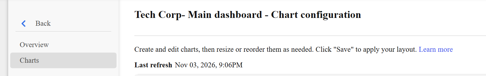

# Report Builder中的可视化

Report Builder中的可视化功能可将保存的报告转换为图表和仪表板。 可在电子表格工具中比较组、发现趋势并共享结果，而无需改变数据形状。

>[!IMPORTANT]
>
>Report Builder中的可视化（图表和仪表板）仅适用于Adobe Learning Manager Ultimate客户。 它们在Prime版本中不可用。

## 关于Report Builder中的可视化 {#about-visualizations}

可视化是从Report Builder中保存的报告生成的图表或图表仪表板。 选择要绘制的报表列，Report Builder从报表数据绘制图表。 您可以直接绘制列，或从报表绘制摘要数据。

* **为报告构建图表：**&#x200B;打开报告，选择&#x200B;**可视化**，然后创建图表。 请参阅[从报表创建图表](#create-chart-from-report)。
* **在仪表板上将图表分组：**&#x200B;选择报表作为数据源，然后从其中添加图表。 请参阅[生成仪表板](#build-dashboard)。
* **共享和查看：**&#x200B;与管理员共享仪表板，管理员在只读模式下查看和筛选仪表板。

图表有两种工作模式：

* **配置模式：**&#x200B;创建或编辑图表。
* **查看模式：**&#x200B;您可以筛选图表显示的内容，而不更改其生成方式。

## 图表类型以及何时使用它们 {#chart-types}

根据要回答的问题选择图表类型。

| 图表类型 | 使用它可以 | 示例 |
|---|---|---|
| 线形图 | 显示值如何随时间变化。 | 按创建月份列出的注册 |
| 条形或柱形 | 跨类别比较值。 分组、栈叠和100%栈叠布局可用。 | 按注册状态显示的学习者 |
| 饼图 | 显示每个类别在整体中所占的份额。 低于1%的段将被分组为&#x200B;**其他**&#x200B;段。 | 按目录列出的注册 |
| 大数字 | 突出显示一个关键指标。 | 本季度完成总数 |
| 表 | 显示精确值。 您可以选择列的子集，并将一个日期列显示为行而不是列（列到行视图）。 | 每个用户每月花费的学习时间 |

>[!NOTE]
>
>根据趋势报告（如按月注册）构建的折线图显示了按日期分组的数据的当前快照。 它们不会显示数据是如何看待过去每个日期的。 有关更多信息，请参阅Report Builder概念和术语。

## 可视化术语 {#visualization-terms}

| 术语 | 含义 |
|---|---|
| 报告 | 列、筛选器和分组的Report Builder配置。 图表是从报表生成的。 |
| 图表级别过滤器 | 在创建或编辑图表时设置的过滤器。 它限制图表绘制的数据。 |
| 页面级别过滤器 | 过滤器查看器应用于页面或仪表板上的所有图表。 它可以缩小报告自身的筛选范围，但不会扩大范围。 |
| Report Builder信息板 | 在Report Builder中构建的图表页。 |

## 从报表创建图表 {#create-chart-from-report}

从保存的报告创建图表，以便快速查看注册数据、完成数据或花费时间数据。 只需配置一次图表，每次打开图表时，图表都会从报表数据中进行绘制。

### 创建图表之前 {#before-you-create-chart}

确认以下内容：

* **保存报告。** 保存报告后，添加图表的选项会显示在“Report Builder”页上。
* **使用您自己的报表。** 复制共享报告以创建您自己的副本，然后使用它创建图表。
* **检查大小。** 无法绘制行数超过1000万的报表。 未绘制超过10,000个数据点的摘要报告。 请参阅图表和仪表板限制。
* **了解您的列。** 图表的X轴（维）和Y轴（度量）来自报表的列。 要汇总报表本身，请使用&#x200B;**Group by**&#x200B;和聚合。 有关详细信息，请参阅应用分组依据和聚合。

### 配置图表 {#configure-chart}

1. 以管理员身份登录到Adobe Learning Manager 。
1. 选择&#x200B;**报表**，然后选择&#x200B;**Report Builder**。
1. 选择“**报告**”选项卡，然后打开保存的报告。 在此示例中，选择用户登录趋势报告，该报告显示每个日期登录学习平台的用户数。
1. 在左侧导航栏中，选择&#x200B;**可视化**。 此时会打开一个面板，其中包含&#x200B;**设置**&#x200B;和&#x200B;**样式**&#x200B;选项卡。

   

   >[!NOTE]
   >
   >在图表存在后，选择&#x200B;**编辑**，然后选择&#x200B;**+**&#x200B;以添加其他图表。

1. 在&#x200B;**图表类型**&#x200B;中，选择一种类型，例如&#x200B;**折线图**。 该字段为必填项。
1. 在&#x200B;**Dimension- X轴**&#x200B;旁边，选择“添加”图标，然后选择报告列。 对于日期列，还要选择&#x200B;**日期粒度**，例如日或月。

   {width="650"}

1. 选择&#x200B;**添加**&#x200B;以添加日期维度。
1. 在&#x200B;**度量 — Y轴**&#x200B;旁边，选择“添加”图标，然后选择报表列以及如何聚合该列，例如&#x200B;**计数**。

   {width="650"}

1. 选择&#x200B;**添加**&#x200B;以添加度量值。
1. （可选）选择&#x200B;**添加筛选器**&#x200B;以将绘制的数据限制在某个范围内，例如最近30天。 选择&#x200B;**添加**。

   {width="650"}

1. （可选）添加&#x200B;**排序**&#x200B;列，然后选择&#x200B;**升序**&#x200B;或&#x200B;**降序**。 选择&#x200B;**添加**。

   {width="650"}

1. （可选）对于折线图，为缺失数据设置&#x200B;**间隙处理**。 请参阅[缺失数据的间隙处理](#gap-handling)。
1. 在&#x200B;**最大数据点数**&#x200B;中，输入要绘制在图表上的数据点数。 默认值为100点，限制为10,000。
1. 启用&#x200B;**将其余点分组为“其他”**。 Report Builder最多可显示&#x200B;**个最大数据点**&#x200B;值的单个数据点，并将超过该限制的所有内容合并为一个名为&#x200B;**其他**&#x200B;的附加类别。

   例如，如果&#x200B;**最大数据点**&#x200B;为150，而您的查询返回200点：

   * Report Builder单独显示150点。
   * Report Builder将其余50点合并为&#x200B;**其他**。
   * 此图表显示151个绘制点：150加上&#x200B;**其他**。

1. 选择&#x200B;**下一步**。 您现在可以自定义图表。

   {width="650"}

#### 缺失数据的间隙处理 {#gap-handling}

间隙处理定义当序列中的一个或多个观察值没有数值（如NULL、NA、NaN或空单元格）时图表执行的操作。

假设数据为：

| X | 值 |
|---|---|
| 一月 | 10 |
| 二月 | 15 |
| 三月 | 无 |
| 四月 | 无 |
| 五月 | 25 |

下表显示了三个行为。

| 间隙处理 | 概念性结果 | 如何绘制 |
|---|---|---|
| 行到零 | `10 -> 15 -> 0 -> 0 -> 25` | 将缺少的值视为0。 |
| 跳过 | `10 -> 15   25` | 不绘制缺少的点，并断开线条。 |
| 连接 | `10 -> 15 ----> 25` | 不绘制缺少的点，但连接两边的有效观察结果。 |

>[!NOTE]
>
>Connect不是插值。 如果缺少3月和4月，则将2月直接连接到5月只会在两个已知值之间绘制一条视觉线。 它不会创建实际的3月和4月值。

### 自定义图表 {#customize-chart}

自定义图表，使其清晰易读。 在&#x200B;**样式**&#x200B;选项卡上，您可以添加标题、显示或隐藏轴标题和图例、定位和对齐图例，并为每个系列设置颜色。 样式更改仅影响图表的外观。 它们不会改变所绘制的数据。

1. 要在图表上方显示标题，请选择&#x200B;**显示图表的标题**。 要隐藏它，请关闭该选项。
1. 在&#x200B;**图表标题**&#x200B;中，输入图表的标题。
1. 选择&#x200B;**显示X轴的标题**&#x200B;和&#x200B;**显示Y轴的标题**&#x200B;以标记轴。
1. 若要显示标识每行的键，请选择&#x200B;**显示图例**。
1. 在&#x200B;**图例位置**&#x200B;中，选择左图标、居中图标或右图标以对齐图例。
1. 在&#x200B;**线条颜色**&#x200B;下，选择序列旁边的颜色色板，例如&#x200B;**用户数**。
1. 在拾色器中，从调色板中选择一种颜色，或使用自定义选项卡来定义自己的颜色。
1. 对要重新着色的每行重复前两个步骤。
1. 选择&#x200B;**创建**&#x200B;以添加图表。 如果您正在编辑现有图表，请选择&#x200B;**保存**。

   {width="650"}

此时会出现图表，其中包含您的标题、图例和线条颜色。

>[!TIP]
>
>* 选择相互之间以及与背景之间对比清晰的颜色。 保留标题和图例等，以便颜色不是区分线条的唯一方式。
>* 仅当打开&#x200B;**显示图例**&#x200B;时，**图例位置**、**图例对齐方式**&#x200B;和&#x200B;**线条颜色**&#x200B;选项才适用。
>* 图表中的每条线都有自己的色板，在&#x200B;**设置**&#x200B;选项卡上添加的每个度量都有一个色板。

要在单个页面上排列图表，请参阅[构建仪表板](#build-dashboard)。

## 创建饼图 {#create-pie-chart}

使用饼图显示整体如何划分为几个部分，例如完成必修培训的员工比例或课程格式组合。 每个切片显示一个类别在总数中所占的份额。

### 关于饼图 {#about-pie-charts}

饼图为每个类别绘制一个扇区。 切片大小显示该类别在总测量中所占的份额。 图例标识每个切片，每个切片显示其值。

当查看者需要比精确值更多的比例时，可使用饼图显示几个类别的整体部分。 要比较多个类别，请使用条形图。 要显示随时间发生的变化，请使用折线图。

### 创建饼图的步骤 {#pie-chart-steps}

在开始之前，请保存您拥有的报告。 包括一个类别列和一个要进行度量的列。

1. 选择&#x200B;**报表**，然后选择&#x200B;**Report Builder**。 在“**报告**”选项卡上，打开保存的报告。
1. 在左侧导航栏中，选择&#x200B;**可视化**。
1. 在&#x200B;**图表类型**&#x200B;中，选择&#x200B;**饼图**。
1. 在&#x200B;**Dimension — 段**&#x200B;旁边，选择“添加”图标，然后选择定义切片的列。 例如，选择&#x200B;**成绩单（学习对象） — 状态**。
1. 在&#x200B;**度量 — 值**&#x200B;旁边，选择“添加”图标，然后选择列并聚合该列以调整切片大小，例如&#x200B;**计数**。
1. （可选）在&#x200B;**最大数据点数**&#x200B;中，输入要绘制的最大切片数。 默认值为100。
1. （可选）要合并次要类别，请打开&#x200B;**将其余点分组为“其他”**。
1. 选择&#x200B;**下一步**&#x200B;以自定义饼图。

### 自定义饼图 {#customize-pie-chart}

1. 要显示标题，请打开&#x200B;**显示图表标题**。 关闭它以隐藏标题。
1. 在&#x200B;**图表标题**&#x200B;中输入标题，例如`Mandatory Compliance Completion`。
1. 在&#x200B;**图表样式**&#x200B;中，选择&#x200B;**饼形**&#x200B;作为实心圆形，或选择&#x200B;**甜甜圈**&#x200B;作为圆环。
1. 选择&#x200B;**显示图例**&#x200B;以在图表中显示图例。
1. 在&#x200B;**图例位置**&#x200B;中，选择图例显示的位置。
1. 在&#x200B;**图例对齐方式**&#x200B;中，选择“左”、“中”或“右”。
1. 为新图表选择&#x200B;**创建**。 编辑现有图表时，请选择&#x200B;**保存**，然后在&#x200B;**可视化**&#x200B;页面上选择&#x200B;**保存**。

   {width="650"}

Report Builder创建饼图或甜甜圈图。

## 创建条形图 {#create-bar-chart}

使用条形图可以跨类别比较度量，例如按团队划分的培训状态或按客户划分的学习时间。 条形图易于比较和排名，您可以对其进行分组或堆叠以添加第二个细分。

### 关于条形图 {#about-bar-charts}

条形图为X轴上的每个类别绘制一个条形图。 条形图的长度显示Y轴上的度量值，例如学习者计数。 可以垂直（栏）或水平绘制条。

使用条形图可以：

* 跨类别（如团队、合作伙伴或客户）比较值。
* 按类别从高到低的顺序排名。
* 在每个栏中显示第二个细目，例如每个合作伙伴内的状态。

### 创建条形图之前 {#before-you-create-bar-chart}

* 保存报告并使用您自己的报告。
* 包括类别列和要度量的列。
* 将报告限制在图表限制和信息板限制内。

### 创建条形图的步骤 {#bar-chart-steps}

1. 选择&#x200B;**报表**，然后选择&#x200B;**Report Builder**。 在“**报告**”选项卡上，打开保存的报告。
1. 在左侧导航栏中，选择&#x200B;**可视化**。
1. 在&#x200B;**图表类型**&#x200B;中选择&#x200B;**条形图**。
1. 在&#x200B;**Dimension- X轴**&#x200B;旁边，选择“添加”图标，然后选择定义类别的列。 选择&#x200B;**完成**。

   {width="650"}

1. 在&#x200B;**度量 — Y轴**&#x200B;旁边，选择“添加”图标，然后选择列以及如何聚合列，例如&#x200B;**计数**。 选择&#x200B;**完成**。

   {width="650"}

1. （可选）添加&#x200B;**筛选器**&#x200B;以限制数据，并设置&#x200B;**排序**&#x200B;以按列对条形进行排序。
1. 在&#x200B;**最大数据点数**&#x200B;中，输入要绘制的最大数据点数。 如果输入150，则Report Builder最多可显示150个单独的数据点，并将超过该限制的所有内容合并到一个名为&#x200B;**其他**&#x200B;的附加类别中。
1. 选择&#x200B;**下一步**&#x200B;以自定义条形图。

### 自定义条形图 {#customize-bar-chart}

使用&#x200B;**样式**&#x200B;选项卡设置标题、方向、分组、图例和颜色。 样式设置更改图表的外观，而不是图表绘制的数据。

1. 选择“**样式**”选项卡。
1. 要显示标题，请打开&#x200B;**显示图表标题**。 在&#x200B;**图表标题**&#x200B;中输入标题，例如`Most Popular Courses`。
1. 要标记轴，请打开&#x200B;**显示X轴的标题**&#x200B;和&#x200B;**显示Y轴的标题**。 关闭某个选项以隐藏该标题。
1. 在&#x200B;**图表样式**&#x200B;中，为列选择&#x200B;**垂直**，或为横向运行的条形选择&#x200B;**水平**。 水平条为长类别名称留出更多空间。
1. 在&#x200B;**条状分组**&#x200B;中，选择三个图标之一以设置多个序列共享类别的方式：分组、栈叠或100%栈叠。
1. 要识别每个系列，请打开&#x200B;**显示图例**。
1. 在&#x200B;**图例位置**&#x200B;中，选择图例显示的位置。 在&#x200B;**图例对齐方式**&#x200B;中，选择“左”、“中”或“右”。
1. 在&#x200B;**条颜色**&#x200B;下，选择序列旁边的色板，然后选择一种颜色。
1. 为新图表选择&#x200B;**创建**。 编辑现有图表时，请选择&#x200B;**保存**。

>[!NOTE]
>
>仅当条包含多个序列（如两个度量）时，**条分组**&#x200B;才重要。 保持图例显示数据标签，所以颜色并不是区分系列的唯一方式。

## 创建大数字 {#create-big-number}

使用大数字可以将一个关键指标显示为易于阅读的大数字，例如学习者总数、逾期注册数或活动用户数。 大数字在仪表板顶部效果很好，观众首先查看关键数字。

### 关于大数字 {#about-big-numbers}

大数字是包含两个部分的拼贴：值和标签。 该值是从您的报表中计算的单个数字，如计数或和。 标签告诉观看者数字的含义。 大数字没有轴、图例或类别。

使用大数字可以：

* 显示某人定期检查的标题数字。
* 在仪表板下方显示详细图表之前为其提供上下文。

### 创建大数的步骤 {#big-number-steps}

开始之前，请保存您自己的报告。 确定需要的一个数字，以及哪列和集合生成该数字。

例如，培训管理员每月报告公司完成了多少培训。 领导者需要一个标题数字，而不是注册列表，管理员希望在不重新生成报告的情况下对其进行刷新。

1. 选择&#x200B;**报表**，然后选择&#x200B;**Report Builder**。 在“**报告**”选项卡上，打开保存的报告。
1. 在左侧导航栏中，选择&#x200B;**可视化**。
1. 在&#x200B;**图表类型**&#x200B;中，选择&#x200B;**大数字**。
1. 在&#x200B;**度量 — 值**&#x200B;中，选择&#x200B;**转录（学习对象） — 状态**，然后应用&#x200B;**计数**&#x200B;聚合。 选择&#x200B;**完成**。

   {width="650"}

1. 选择在小数点后显示的位数。 您至多可以选择两个数字。
1. 在&#x200B;**显示单位**&#x200B;中，选择如何缩短大数字。 选择&#x200B;**千位**、百万位&#x200B;**千位**、十亿位&#x200B;**B**&#x200B;或&#x200B;**无**&#x200B;以显示完整值。 **自动**&#x200B;自动选择适当的单位。 选择&#x200B;**下一步**。

   {width="650"}

### 自定义大数字 {#customize-big-number}

使用&#x200B;**样式**&#x200B;选项卡自定义大数的图例属性。

1. 在&#x200B;**图例标题**&#x200B;中，输入命名数字的文本。 例如，输入`Total Course Completions`。
1. 在&#x200B;**图例位置**&#x200B;中，选择两个图标之一以设置标题的显示位置。
1. 在&#x200B;**图例对齐方式**&#x200B;中，选择“左”、“中”或“右”。
1. 为新图表选择&#x200B;**创建**。 编辑现有图表时，请选择&#x200B;**保存**。

   {width="650"}

## 创建表或数据透视图 {#create-table-pivot-chart}

使用数据透视表可以总结两个类别中的数字，例如每个经理团队中已完成、开始或未开始所需学习的学习者数量。 您也可以切换到透视样式视图，其中的日期或类别在表顶部跨越，因此每个学习者或课程适合一行。

### 关于表和数据透视图 {#about-table-pivot}

数据透视表是指侧边有一个类别、顶部有一个类别和每个单元格中有一个数字的网格。 每个单元格显示一个行值和一个列值的度量。 在&#x200B;**设置**&#x200B;选项卡上使用三个设置构建它。

| 设置 | 功能 | 在此示例中 |
|---|---|---|
| **Dimension — 列** | 该字段的值将变为位于顶部的列标题。 | **成绩单（学习对象） — 状态**：已完成、进行中、未开始 |
| **Dimension — 行** | 此字段的值将变为左侧下方的行标签，每个值一行。 | **用户 — 经理姓名** |
| **度量 — 值** | 每个单元格中的数字。 选择列和聚合，如&#x200B;**计数**。 它显示为列名，后跟&#x200B;**聚合者：计数**。 | 学习者数 |

维是按其进行分组的域。 度量是您计算的数字。

### 创建表图表之前 {#before-you-create-table-chart}

* 要使用列到行视图，请按要作为标题的列（如日期）对报表进行分组。
* 如果您按多个日期列分组，请选择其中一个作为标题。

### 创建表图表的步骤 {#table-chart-steps}

1. 选择&#x200B;**报表**，然后选择&#x200B;**Report Builder**。 在“**报告**”选项卡上，打开保存的报告。
1. 在左侧导航栏中，选择&#x200B;**可视化**。
1. 在&#x200B;**图表类型**&#x200B;中，选择&#x200B;**表/透视**。
1. 在&#x200B;**Dimension — 行**&#x200B;旁边，选择“添加”图标，然后选择&#x200B;**用户 — 管理员名称**。
1. 在&#x200B;**Dimension — 列**&#x200B;旁边，选择添加图标，然后选择&#x200B;**成绩单（学习对象） — 状态**。
1. 在&#x200B;**度量值 — 值**&#x200B;旁边，选择“添加”图标。 选择度量值&#x200B;**成绩单（学习对象） — 状态**，然后选择&#x200B;**添加**。

   {width="650"}

1. 根据您的报告要求，打开以下任一选项或同时打开两个选项：

   * **显示列的总计：**&#x200B;显示每一列的总计。 例如，如果表显示不同区域的销售数据，则总计将显示每一列的销售总额。
   * **显示行的总计：**&#x200B;显示每行的总计。 例如，如果表显示不同产品之间的每月销售额，则总计将显示每一行的总销售额。

1. 在&#x200B;**要显示的行数（最多20行）**&#x200B;中，输入要在表中一次显示多少行。 默认值为10，最大值为20。 例如，15表示每页显示15行。
1. 选择&#x200B;**下一步**。

### 自定义表 {#customize-table}

使用&#x200B;**样式**&#x200B;选项卡添加图表标题、为表头着色和为表行着色。

1. 在&#x200B;**图表标题**&#x200B;中，输入要显示的标题，如`Status of Learning`。
1. 选择&#x200B;**标题行颜色**&#x200B;将背景颜色应用于标题行。
1. 打开&#x200B;**突出显示替代行**&#x200B;以将替代颜色应用于行以方便阅读。
1. 选择“**颜色1**”，并为交替行选择第一种颜色。
1. 选择“**颜色2**”，并为替代行选择第二种颜色。
1. 选择&#x200B;**保存**&#x200B;以将样式设置应用于图表。

## 生成仪表板 {#build-dashboard}

仪表板可将一个或多个报告中的图表放在一个页面上。 反复回答相同的问题（例如本月完成培训的人数，或者哪些团队落后）时，建立一个。

### 关于Report Builder仪表板 {#about-dashboards}

仪表板是一页图表。 选择从中绘制的报表（称为其数据源），然后从这些报表中添加图表。 图表始终来自报告，因此应首先在每个报告的&#x200B;**可视化**&#x200B;页面上创建图表。 您只能使用自己拥有的报告。 范围界定适用于仪表板上的每个图表。

### 创建仪表板 {#create-dashboard}

1. 选择&#x200B;**报告** > **仪表板**。 该页面会列出您创建的所有面板。
1. 选择&#x200B;**创建仪表板**。
1. 输入信息板的名称和说明。

   {width="650"}

1. 在&#x200B;**数据源**&#x200B;中，选择&#x200B;**添加报告**&#x200B;以从可用报告中添加预先创建的图表。
1. 从列表中选择一个或多个报表，然后选择&#x200B;**添加**。

   {width="650"}

Report Builder将报告添加到信息板。

{width="650"}

### 查看仪表板中的图表 {#view-charts}

在仪表板的左侧导航窗格中选择&#x200B;**图表**。

{width="650"}

可用报告中的所有图表都会显示在信息板上。

{width="650"}

### 在仪表板中移动图表 {#move-charts}

1. 选择仪表板右上角的&#x200B;**编辑**。 您可以查看每个报告中用于创建图表的列。 您还可以创建另一个图表以添加到仪表板。

   {width="650"}

1. 从左侧面板中，选择要添加到仪表板中的图表。
1. 将每个图表拖到所需位置，然后释放以放置图表。
1. 重复上一步骤以根据您的报告要求排列图表。
1. 选择&#x200B;**保存**&#x200B;以保存仪表板中的所有更改。

### 共享信息板 {#share-dashboard}

与其他管理员共享Report Builder信息板，以便他们可以查看相同的图表和数据。

从报告创建的图表将与该报告一起保存。 当您共享报告时，其他管理员也会获得图表。 共享一次信息板，而不是要求每个管理员重新构建它。

#### 与其他管理员共享信息板 {#share-with-administrators}

1. 以管理员身份登录到Adobe Learning Manager 。
1. 选择&#x200B;**报表**，然后选择&#x200B;**Report Builder**。
1. 选择“**报告**”选项卡，然后打开包含仪表板的报告。
1. 选择&#x200B;**操作** > **共享**。
1. 在&#x200B;**共享**&#x200B;下，选择&#x200B;**编辑**。
1. 选择&#x200B;**选择用户/用户组**&#x200B;字段。
1. 搜索并选择要与之共享的管理员或用户组。

   {width="650"}

1. 选择&#x200B;**“保存”**。

选定的管理员现在可以在Report Builder视图中查看报告及其图表。

>[!NOTE]
>
>具有共享访问权限的管理员可以查看、复制和编辑报告。

#### 删除共享访问权限 {#remove-shared-access}

1. 打开报告，然后选择&#x200B;**操作** > **共享**。
1. 在&#x200B;**共享**&#x200B;下，选择&#x200B;**编辑**。
1. 取消选择管理员或用户组。
1. 选择&#x200B;**“保存”**。

#### 共享的最佳实践 {#sharing-best-practices}

* 共享一个配置良好的报告，而不是让每个管理员构建一个变体。 这将保留一个授权版本的数据。
* 使用适用于您与之共享的所有人的过滤器创建报告，以便所有查看者看到一致的图表。

### 删除信息板 {#delete-dashboard}

不再需要Report Builder信息板时，请将其删除。 删除仪表板会永久删除仪表板及其关联的共享设置。 无法撤消此操作。

1. 以管理员身份登录到Adobe Learning Manager 。
1. 选择&#x200B;**报表**，然后选择&#x200B;**Report Builder**。
1. 选择“**报告**”选项卡，然后打开要删除的仪表板。
1. 选择&#x200B;**操作** > **删除**。 此时会显示&#x200B;**需要确认**&#x200B;对话框。 此时将显示信息板名称以及与之共享信息板的用户。

   {width="650"}

1. 选择下列选项之一：

   * **编辑共享：**&#x200B;审阅或更改与之共享仪表板的用户。
   * **取消：**&#x200B;关闭对话框，不删除仪表板。
   * **删除仪表板：**&#x200B;永久删除仪表板并删除其共享设置。