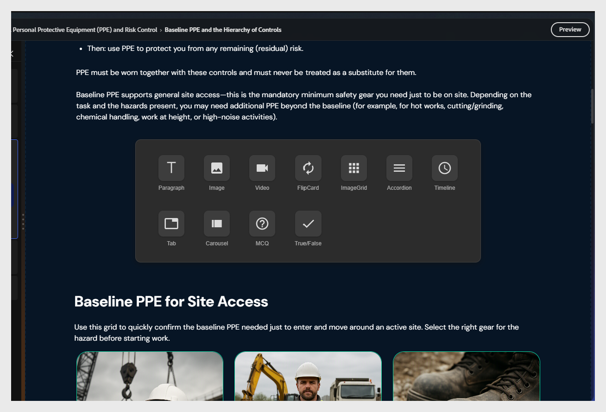
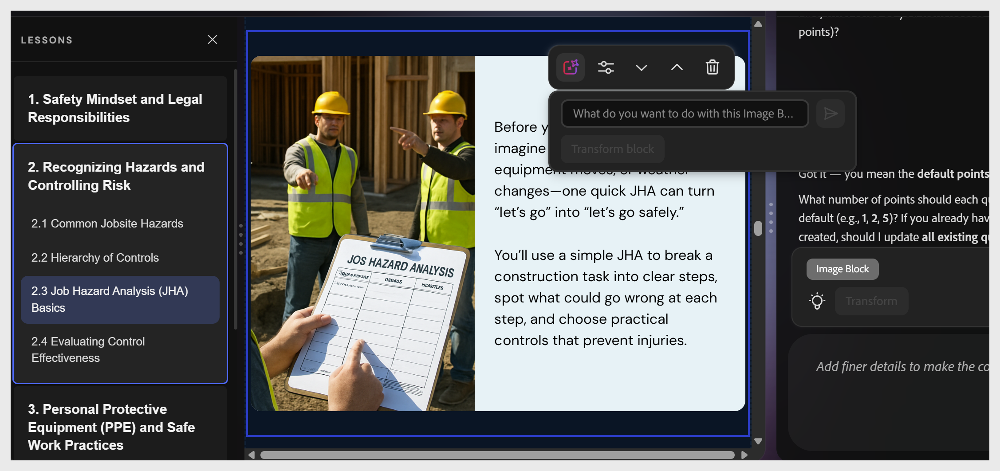

# 添加内容组件

在两个现有元素之间进行选择。 出现+按钮。 选择它以打开组件选取器。

可用组件：

<table>
  <thead>
    <tr>
      <th>组件</th>
      <th>用于</th>
    </tr>
  </thead>
  <tbody>
    <tr>
      <td><strong>段落</strong></td>
      <td>正文文本和说明</td>
    </tr>
    <tr>
      <td><strong>图像</strong></td>
      <td>插图、屏幕截图、图表</td>
    </tr>
    <tr>
      <td><strong>视频</strong></td>
      <td>嵌入的MP4或链接视频</td>
    </tr>
    <tr>
      <td><strong>翻转卡</strong></td>
      <td>术语或定义对，显示交互</td>
    </tr>
    <tr>
      <td><strong>图像网格</strong></td>
      <td>一个网格布局中包含多个图像</td>
    </tr>
    <tr>
      <td><strong>可折叠项</strong></td>
      <td>可展开的章节，分步步骤</td>
    </tr>
    <tr>
      <td><strong>时间线</strong></td>
      <td>顺序事件或流程步骤</td>
    </tr>
    <tr>
      <td><strong>Web对象</strong></td>
      <td>将外部Web内容、网页、交互式工具、调查表或Web应用程序直接嵌入到主题幻灯片中</td>
    </tr>
    <tr>
      <td><strong>选项卡</strong></td>
      <td>并行内容 — 比较、地区变体</td>
    </tr>
    <tr>
      <td><strong>轮播</strong></td>
      <td>一系列可滑动的图像或内容卡</td>
    </tr>
    <tr>
      <td><strong>MCQ</strong></td>
      <td>内联未分级知识检查</td>
    </tr>
    <tr>
      <td><strong>对/错</strong></td>
      <td>内联未分级的True或False检查</td>
    </tr>
  </tbody>
</table>

>[!NOTE]
>
>使用&#x200B;**折叠面板**&#x200B;执行分步学习程序，学习者可以通过控制节奏来获得好处。 将&#x200B;**翻转卡**&#x200B;用于术语或定义内容。

## 将Web对象添加到内容编辑器课程

Web对象以内联帧显示课程中的外部内容。 学习者无需离开课程即可与内容进行交互。 可用于交互式工具、嵌入式表单、调查或任何支持iframe嵌入的基于Web的资源。

### 添加Web对象

1. 在Content Composer中打开课程，并导航到要添加Web对象的主题。
2. 在主题幻灯片上的两个现有元素之间进行选择。 出现&#x200B;**+**&#x200B;按钮。
3. 选择“**+**”以打开组件选取器。
4. 选择&#x200B;**Web对象**。 该块将显示在画布上。

### 配置Web对象

选择Web对象块工具栏上的&#x200B;**设置**&#x200B;图标以打开配置面板。

### 设置内容源

在&#x200B;**内容**&#x200B;下，选择外部内容的加载方式：

- **URL** — 输入要嵌入的页面或工具的Web地址。 内容以内联帧加载到课程内。
- **嵌入代码** — 粘贴来自第三方服务的嵌入片段。 此选项用于提供自己的嵌入代码的工具，如交互式表单、调查表或媒体播放器。
- **系统** — 从连接的系统或集成中选择内容。

### 设置Height

在&#x200B;**Height**&#x200B;字段中，设置嵌入内容帧的Height（以像素为单位）。 使用&#x200B;**+**&#x200B;和&#x200B;**−**&#x200B;控件调整该值。 默认为498 px。

调整Height以匹配嵌入内容的自然Height。 将它设置为太低会在帧内添加一个滚动条；将它设置为太高会在内容下方添加空白区。

### 配置加载和显示选项

- **自动加载** — 选中此选项后，当学习者到达幻灯片时，Web内容会自动加载。 对于内容繁重的页面，请清除此选项，以免减慢课程速度。 自动加载关闭后，学习者会选择触发加载的帧。
- **块标题** — 打开以在Web对象块上方显示标题。 使用此功能可在学习者与嵌入内容交互之前为其提供有关嵌入内容的上下文。

## 在主题内移动内容块

您可以使用工具栏中的编辑选项或AI对主题中的内容块进行重新排序。

