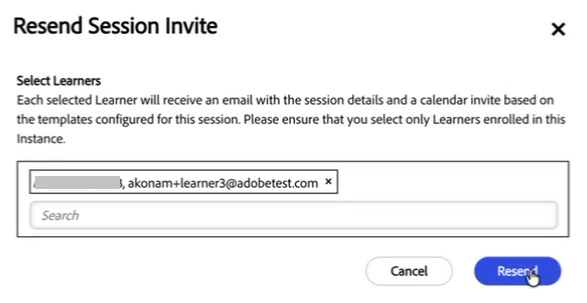

# 重新发送会话邀请

## 概述

>[!NOTE]
>
>重新触发仅适用于虚拟教室(VC)会话。 不支持其他模块类型，例如教室和自学模块。

学习者可能由于多种原因而错过邀请。 作为有权编辑课程的管理员，您可以使用&#x200B;**重新发送**&#x200B;选项在实例页面上打开虚拟教室会话、搜索学习者并发送会话邀请电子邮件。 Learning Manager会在注册事件流之外按需发送电子邮件。 学习者会收到会话详细信息和日历邀请，且注册状态保持不变。

## 用例

以下是重新发送会话邀请的用例。

* **恢复错过的邀请。** 将邀请重新发送给其邮箱已满、电子邮件被垃圾邮件或其原始电子邮件未送达的学习者。
* **减少不显示。** 在会话之前或会话日期重新发送会话详细信息和日历邀请。
* **避免使用注册解决方法。** 重新发送邀请，而无需取消注册和重新注册学习者，因此注册状态和会话注册将保持不变。
* **减少支持票证。** 管理员可以自行解决“缺少邀请”请求，无需支持团队参与。

## 先决条件

* 会话为VC会话。
* 学习者已注册目标会话。 Learning Manager仅将邀请发送给已注册会话的学习者。
* 会话已存在。 此功能不会创建或修改会话。
* 使用现有的会话邀请电子邮件模板。 此功能不会引入新的电子邮件模板。

## 支持的配置

| 项目 | 支持 |
|--------------------|-----------------------------------------------------------------------------------------------------------|
| 角色 | 具有编辑课程权限的管理员。 讲师了解分配给他们的会话。 |
| 目录项类型 | 课程和学习路径 |
| 模块类型 | 虚拟教室(VC)会话 |
| 会话 | 当前和未来的会议。 不支持过去的会话。 |
| VC提供商 | 为会话配置的所有提供商，例如Zoom、Teams和Adobe Connect |
| 电子邮件模板 | 为学习对象配置的模板：会话详细信息电子邮件和日历邀请 |
| 收件人 | 已注册会话的单个学习者。 不支持用户组。 |
| 触发器 | 手动，从重新发送会话邀请操作 |

在此版本中，经理角色无权访问此功能。 学习者和经理无法看到此选项。

## 访问重新发送会话邀请操作

操作的位置取决于您的角色。

| 角色 | 在哪里可以找到操作 |
|---------------|-----------------------------------------------------------------------------------------------------------------------------------------------------------------------------------------------------------------|
| 管理员 | 打开目录中的课程或学习路径，转到“实例”，然后打开实例。 在“会话”部分中，找到VC会话，然后选择“重新发送会话邀请” 。 您需要获得编辑课程的权限。 |

## 重新发送对话框

“重新发送会话邀请”对话框包含以下元素。

| 元素 | 描述 |
|-----------------|---------------------------------------------------------------------------------------------------------------------------------------------------------------------------------------------------------------------------------------------------------------------------------------------------------------------------|
| 选择学习者 | 搜索字段。 输入学习者的姓名或电子邮件地址以查找该学习者，然后选择该学习者。 您可以选择多个学习者。 注意：根据为学习对象配置的模板，每个选定学习者都会收到两封电子邮件，即会话详细信息电子邮件和日历邀请。 |
| 取消 | 关闭对话框而不发送任何电子邮件。 |
| 重新发送 | 向选定学习者发送电子邮件。 在至少选择一个学习者之前，该按钮将处于禁用状态。 |

>[!NOTE]
>
>搜索仅匹配单个学习者。 您无法搜索或选择用户组。

## 重新发送会话邀请

以管理员身份完成以下步骤。

1. 以有权编辑课程的管理员身份登录。
2. 导航至&#x200B;**学习** > **课程**。

   

3. 打开要访问其实例的课程。

   

4. 导航到要访问其会话的实例。
5. 在下面的&#x200B;**会话详细信息**&#x200B;部分中，选择&#x200B;**重新发送会话邀请**。

   

6. 将打开&#x200B;**重新发送会话邀请**&#x200B;弹出窗口。

   

7. 搜索要向其重新发送邀请的一个或多个学习者。

   

   

8. 选择&#x200B;**重新发送**。 您会看到一条消息，显示“会话邀请已发送给“x”个学习者。”

   

9. 如果所选的学习者之一来自其他会话，您会看到一条消息，提示“X所选的学习者未注册此会话，已跳过”。

   

10. 几分钟后，学习者将会收到一封包含会话详细信息的邮件，其中包含加入会话的链接。

Learning Manager会验证所选的每个学习者是否已注册目标会话，然后将现有会话邀请发送给符合条件的学习者。

Learning Manager接受请求后，对话框将关闭并显示确认消息：“系统正在向学习者发送会话邀请电子邮件。 完成此操作可能需要一些时间。” 电子邮件通常在几分钟内到达。

## 电子邮件内容

每个选定学习者都会收到会话详细信息电子邮件和会话日历邀请。 内容包括VC会话加入链接、日期和时间以及会话详细信息。 电子邮件与原始会话邀请相同，因为Learning Manager使用的是相同模板。

## 多注册行为

重新发送特定于实例。 如果学习者注册了多个实例，则从一个实例重新发送时，只会发送该实例的邀请。 它不会重新触发针对学习者其他实例的邀请。

| 学习者注册 | 操作 | 结果 |
|------------------------------------------------|------------------------------------------------|----------------------------------------------------------------------------------|
| 实例A和实例B | 从实例A重新发送 | 仅重新发送邀请实例。 |
| 仅实例A | 从实例A重新发送 | 重新发送邀请实例。 |
| 与选定会话不同的实例 | 此时会在课程级别的搜索中显示该学习者 | Learning Manager会跳过所选会话的学习者并显示警告。 |

## 特定场景中的行为

| 情景 | 行为 |
|--------------------------------------------------------|------------------------------------------------------------------------------------------------------------------------------------------------------------------------------------------------------------------------------|
| 该实例没有VC会话 | 重新发送会话邀请操作不可用。 |
| 会话已经发生 | 该操作不可用。 Learning Manager仅支持当前和未来的会话。 |
| 您可以选择未注册会话的学习者 | 学习者搜索涵盖整个课程，因此您可以查找其他实例中的学习者。 Learning Manager会跳过未注册选定会话的学习者，将邀请发送给其他人并显示警告。 |
| 学习者在多个实例中注册 | Learning Manager仅针对从中发送邀请的实例发送邀请。 它不会发送其他实例的邀请。 |
| 已选择学习路径实例 | 此操作的方式与课程实例相同。 |

## 错误处理

如果错误阻止Learning Manager发送电子邮件，对话框会显示以下消息之一。

| 条件 | 消息 |
|---------------------------------------|------------------------------------------------------------------------|
| 邀请电子邮件模板已禁用 | 无法发送电子邮件：邀请邮件模板当前已禁用。 |
| 任何其他错误 | 发送电子邮件时出错。 请稍后重试。 |

如果选择未注册会话的学习者，Learning Manager会显示警告，提示已跳过这些学习者的邀请。 系统仍会向已注册的学习者发送邀请。

>[!NOTE]
>
>关闭对话框后，电子邮件服务会以异步方式向Learning Manager报告交付状态。

## 限制

* 您只能为当前和未来的会话重新发送邀请。
* 系统只会使用为学习对象配置的模板。 无法选择其他模板。
* 您可以一次重新发送一个会话的邀请。 不支持一次在多个实例之间重新发送。
* 您无法选择用户组。 您只能选择单个学习者。
* Learning Manager仅向已注册选定会话的学习者发送邀请。
* 此对话框不显示电子邮件的发送状态，并且不为个别学习者提供重试选项。
* 您无法从对话框中安排新会话或编辑现有会话详细信息。

## 故障排除

| 症状 | 可能的原因 | 操作 |
|---------------------------------------------------------------------|-------------------------------------------------------------------------------------------------------------------|---------------------------------------------------------------------------------------------------------------------|
| 重新发送会话邀请操作不可见 | 模块不是VC会话，会话已发生，或者您没有编辑课程的权限。 | 确认该会话为当前或未来的VC会话。 让管理员验证您的课程权限。 |
| 发送电子邮件后显示警告 | 一个或多个选定学习者未在选定会话中注册。 | 检查哪些学习者已注册会话，并从正确的会话或实例重新发送邀请。 |
| 为错误的实例发送邀请 | 该学习者在多个实例中注册，而您从其他实例中重新发送邀请。 | 打开学习者需要的实例，然后从那里重新发送邀请。 |
| 系统会显示错误“邀请电子邮件模板当前已禁用” | 该学习对象的“邀请”电子邮件模板已禁用。 | 请让管理员启用模板，然后重新发送邀请。 |
| 重新发送的电子邮件与原始邀请看起来相同 | 这是预期的。 Learning Manager会重复使用现有的会话邀请模板。 | 无需执行任何操作。 |
| 您需要同时跨多个实例重新发送邀请 | 不支持此项。 | 分别从每个实例重新发送邀请。 |
| 您需要重新发送教室或电子学习模块的邀请 | 不支持此项。 重新触发仅适用于VC会话。 | 这些模块类型无可用操作。 |
| 一名学习者说，邮件没有送达 | 电子邮件仍在处理中，学习者的邮箱已满，或者电子邮件被过滤为垃圾邮件。 | 请稍等几分钟，让学习者检查垃圾邮件文件夹并释放邮箱空间，然后重新发送邀请。 |
