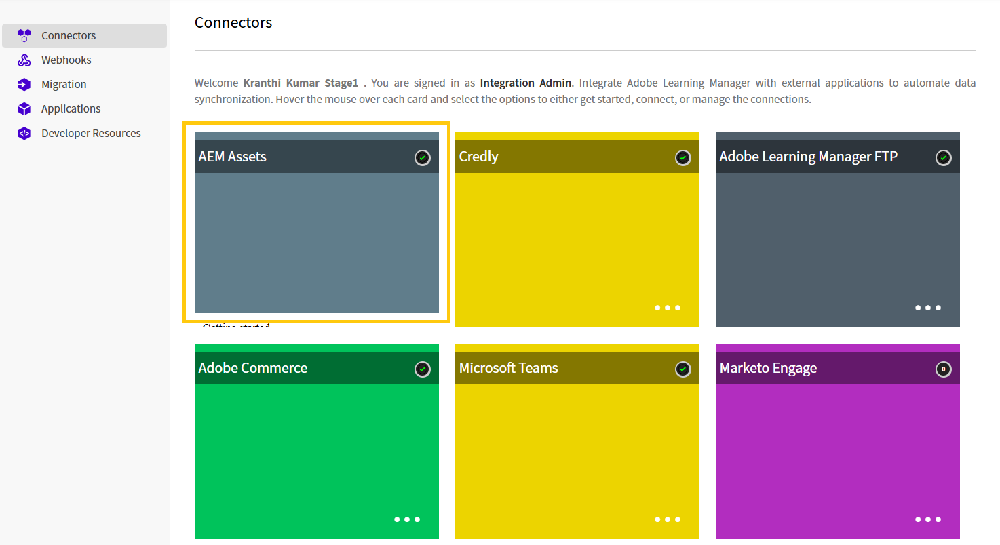

# AEM assets集成

## 概述

Adobe Learning Manager现在与Adobe Experience Manager Assetsas a Cloud Service集成。 团队可以在Adobe Experience Manager Assets中存储学习内容和图像，将它们导入Adobe Learning Manager，并在一个位置管理更新。 当资源更改时，内容库中的链接内容会自动更新，因此作者无需重新上传文件。

由于您的组织在一个位置管理资源，因此作者使用当前获得品牌批准的文件，而不是下载和重新上传副本。 Adobe Experience Manager Assets还会保留每个文件的版本历史记录，从而为您提供版本的实时版本和时间的记录。

安装是一项一次性任务，最需要注意的是安装部分。 设置完成后，导入资源的工作方式与任何其他上传方式一样。

>[!NOTE]
>
>此集成适用于所有拥有Adobe Learning Manager许可证的Adobe Experience Manager Assets帐户，包括Prime帐户和Ultimate帐户。 相同的文档适用于两者。

## 谁做些什么

| 角色 | 他们执行的操作 |
|---|---|
| ALM集成管理员 | 连接帐户并选择集成设置。 |
| Adobe Admin Console管理员 | 将生成的技术帐户分配给正确的AEM Assets产品配置文件。 |
| ALM管理员 | 使用集成从不同位置导入图像。 |
| ALM作者 | 导入内容和图像并构建课程。 |

在设置和使用集成时，每个角色都有一个单独的部分。

## 支持的部署

| 项目 | 支持 |
|---|---|
| as a Cloud Service，作者实例 | 是 |
| as a Cloud Service、发布或交付实例 | 否 |
| Adobe Experience Manager内部部署 | 否 |

>[!NOTE]
>
>Adobe Learning Manager连接到作者实例只是因为在此处创建和管理资源。 Publish和交付实例不是当前集成的一部分。

## 设置集成

将Adobe Learning Manager连接到Adobe Experience Manager Assets，分配技术帐户，然后选择更新设置。

此工作流程适用于集成管理员。 完成每个步骤，以便自动更新适用于您的作者。 设置分为五个部分：连接到您的IMS组织、查找技术帐户、在Adobe Admin Console中分配技术帐户、选择您的设置并授予作者访问权限。

### 先决条件 {#setup-prerequisites}

您必须满足所有这些要求。 缺少其中任何一项是连接失败的最常见原因。

* 您在Adobe Learning Manager中拥有集成管理员角色。 连接工作流程仅适用于此角色。
* 您是所选的Identity Management System (IMS)组织的IMS组织管理员。
* 您至少可访问一个可将AEM Assets实例与Learning Manager关联的组织。

如果您不是IMS组织管理员，请让您的IT管理员授予您访问权限或运行与您的连接。

### Adobe Learning Manager如何映射到您的IMS组织

每个Adobe Learning Manager帐户连接到一个IMS组织（也称为IMS配置文件）。 在规划您的设置时，请记住以下事项：

* 一个IMS组织可以包含多个程序和环境，且每个程序都可以包含Adobe Experience Manager Assets实例。 您可以将这些实例与已连接的帐户一起使用。
* 不同IMS组织中的实例无法与该帐户一起使用。
* 链接到一个Adobe Learning Manager帐户的IMS组织无法同时链接到另一个帐户。

>[!NOTE]
>
>如果您的公司有多个IMS组织，请选择持有您的Adobe Experience Manager Assets许可证的组织以及您希望作者使用的实例。

### 连接到您的IMS组织

1. 以&#x200B;**集成管理员**&#x200B;的身份登录Adobe Learning Manager。
1. 选择&#x200B;**Adobe Experience Manager Assets**&#x200B;作为连接器类型。

   

1. 选择&#x200B;**连接**。

   

1. 出现提示时，使用您的Adobe ID登录，并选择包含您的Adobe Experience Manager Assets实例的IMS组织。

   

   

然后，Adobe Learning Manager验证您的IMS组织管理员角色和实例访问权限。 如果两项检查均通过，则它将您的帐户与已创建的具有AEM Assets作者API范围的IMS帐户关联到选定的IMS组织，并为您的组织创建技术帐户。 然后，将打开连接概述页面并显示技术帐户详细信息。

### 查找技术帐户

技术帐户是专门为您的组织创建的。 Adobe Learning Manager在后台使用AEM Assets [Open API](https://developer.adobe.com/experience-cloud/experience-manager-apis/api/experimental/assets/author/)进行读取或写入。

1. 以&#x200B;**集成管理员**&#x200B;身份登录，打开&#x200B;**Adobe Experience Manager Assets**&#x200B;连接概述页面。
1. 在&#x200B;**凭据**&#x200B;部分中，找到&#x200B;**技术帐户电子邮件**。
1. 复制技术帐户电子邮件。 您将使用该帐户在&#x200B;**Adobe Admin Console**&#x200B;中查找该帐户。

### 在Adobe Admin Console中分配技术帐户

将技术帐户添加到您希望Adobe Learning Manager使用的每个Adobe Experience Manager Assets实例的产品配置文件中。 例如，如果您有10个实例，只想其中的6个使用Adobe Learning Manager，则将帐户分配给这6个实例的配置文件。

1. 以同一IMS组织的管理员身份登录&#x200B;**Adobe Admin Console**。
2. 选择&#x200B;**产品和服务**，然后选择&#x200B;**Adobe Experience Manager as a Cloud Service**。

   

3. 选择要与Adobe Learning Manager一起使用的实例。

   

4. 打开具有Adobe Learning Manager所需访问权限的产品配置文件。 例如， AEM管理员配置文件。

   

5. 选择&#x200B;**添加API凭据**。

   

6. 搜索技术帐户。 请将其与您从集成管理员那里复制的技术帐户电子邮件相匹配。 帐户通常位于列表的底部。

   

7. 选择技术帐户，然后选择&#x200B;**保存**。
8. 对要使用的每个实例重复步骤3到7。

如果配置文件的API凭据列表为空，则尚未分配技术帐户。 要了解有关产品配置文件和API凭据的更多信息，请参阅Adobe Admin Console文档。

>[!IMPORTANT]
>
>不要跳过此步骤。 如果您未分配技术帐户，作者仍可以从Adobe Experience Manager Assets导入资源，但自动更新不起作用。 然后，您必须手动更新内容。

### 选择您的集成设置

连接后，启用连接并选择Adobe Learning Manager处理更新和预览的方式。

| 设置 | 功能 |
|---|---|
| 自动更新 | 在Adobe Experience Manager Assets中更改资源时更新链接的内容库项目。 |
| 更新学习对象 | 还将更新应用于使用内容库项目的学习对象。 |
| 公开预览链接 | 为支持的内容创建预览链接，并将其保存在AEM Assets上的资源元数据中。 |

更新学习对象是自动更新的子设置。 只有首先启用自动更新，才能启用该选项。 如果关闭自动更新，作者则会在内容库中手动更新内容。

>[!IMPORTANT]
>
>对这些设置的更改（包括关闭）最多需要一小时才能生效。 启用连接后，情况也是如此。 延迟并不意味着出了问题。 最多等一小时再进行测试。

### 授予作者访问Adobe Experience Manager Assets的权限 {#give-authors-access}

设置集成并不允许作者访问您的资源。 导入资源的每个Adobe Learning Manager作者或管理员还必须有权访问相应的Adobe Experience Manager Assets作者实例。

* 在同一IMS组织中将作者添加为Adobe Experience Manager Assets作者实例的用户。
* 为他们提供浏览和选择资源所需的至少访问权限。 您的Adobe Experience Manager管理员决定使用哪些角色和产品配置文件。

>[!NOTE]
>
>授予此访问权限是您作为Adobe Experience Manager管理员的责任。 Adobe Learning Manager没有规定特定的角色。 有关用户和配置文件的帮助，请参阅Adobe Experience Manager Assets文档。

### 验证设置

1. 等待上述设置延迟通过。
1. 以具有实例访问权限的作者身份登录。
1. 在&#x200B;**内容库**&#x200B;中，选择&#x200B;**浏览**，并确认&#x200B;**AEM Assets**&#x200B;显示在&#x200B;**设备**&#x200B;旁边。
1. 导入资源并确认其已导入。
1. 如果资源被替换、是新版本或者经过重新处理，则在大多数情况下会在几分钟内进行更新，在极少数情况下可能需要长达一小时。 如果需要的时间超过一小时，您可以在AEM Assets中重新处理资源。

## 从Adobe Experience Manager Assets导入内容

从Adobe Experience Manager Assets导入学习内容和图像，并根据最新内容构建课程。

此工作流程适用于作者。 您的集成管理员必须先设置集成。

### 先决条件 {#import-prerequisites}

* 您的集成管理员已连接帐户并启用连接。
* 您有权访问已连接的IMS组织中持有您的资源的Adobe Experience Manager Assets作者实例。 您的Adobe Experience Manager管理员会授予此访问权限。 请参阅[授予作者访问Adobe Experience Manager Assets的权限](#give-authors-access)。

启用集成后，Adobe Learning Manager中支持该集成的任何上传选项都会显示两个源：设备和AEM Assets。 其中包括内容库和课程图像的上传选项。 设备仍然可用，因此您仍然可以从计算机上传文件。

### 可以从何处导入

AEM Assets选项会显示在支持该选项的上传位置。 从设备上传的内容将保留。 您可以导入：

* 内容库中的模块内容。
* 图像，如课程封面图像和横幅图像。
* 工作辅助

只显示该上传位置支持的文件类型。 例如，“封面图像”选项仅显示图像。 支持的类型包括图像(JPEG、PNG、SVG)、视频(MP4)和文档（PDF、SCORM包、PowerPoint和Word）。 文件扩展名和大小限制与该位置的其他上传相同。

### 内容和图像的处理方式不同

| 项目 | 处理方式 |
|---|---|
| 内容库中的内容 | 已复制并链接到源资源，因此它可以自动更新。 |
| 图像，例如封面和横幅图像 | 选择它们时已复制。 它们没有链接，不会自动更新。 |

### 将内容导入内容库

1. 打开&#x200B;**内容库**&#x200B;并添加内容。
1. 选择&#x200B;**浏览**。
1. 选择&#x200B;**AEM Assets**。
1. 如果出现提示，请使用您的Adobe ID登录。
1. 在&#x200B;**Adobe Experience Manager Assets**&#x200B;窗口中，浏览到该资源。 如果您有权访问多个存储库（通过AEM Assets启用的AEM实例），请根据需要在这些存储库之间切换。
1. 选择资源，然后完成上传并保存。
1. 使用内容组创建课程。

请牢记下列事项：

* 一次选择一个资源。 批量导入和文件夹导入不可用，您无法将现有内容库迁移到Adobe Experience Manager Assets。
* 通过资源选取器，可在Adobe Experience Manager Assets中打开资源。
* Adobe Learning Manager不直接从Adobe Experience Manager Assets提供内容。 它会复制每个导入的资源并保留本地副本。
* 导入的内容会像处理Adobe Learning Manager中的任何其他内容一样处理，包括学习者助理的转录。

### 添加工作辅助

从AEM Assets中选择工作辅助文件，例如PDF和参考文档，导入内容库内容的操作与导入内容库内容的方式相同。

### 无访问权限的作者

如果作者无权访问已连接IMS组织的Adobe Experience Manager Assets，则他们在选择AEM Assets时看到一条关于其访问受限的消息。

## 使内容保持最新

在Adobe Experience Manager Assets中资源发生变化时，保持链接的内容库项目为最新状态。

### 自动更新的工作方式

从“集成管理员”部分打开自动更新并分配技术帐户后，Adobe Learning Manager会使“内容库”与Adobe Experience Manager Assets保持同步。

1. 在&#x200B;**Adobe Experience Manager Assets**&#x200B;中，上传资源的新版本或恢复以前的版本。
1. Adobe Experience Manager Assets处理完资源。 如果资源被替换，则在大多数情况下它会在几分钟内更新，在极少数情况下可能需要长达一小时。 如果需要的时间超过一小时，您可以在AEM Assets中重新处理资源。
1. Adobe Learning Manager将更新链接的&#x200B;**内容库**&#x200B;项目并递增版本号。
1. 如果&#x200B;**更新到学习对象**&#x200B;处于启用状态，则使用这些项目的学习对象也会更新。 当前注册的学习者和将来的学习者都将获得最新版本。
1. 学习者在下次启动内容时获取最新版本。 已经打开内容的学习者需要关闭并重新启动该内容。

更新不是即时的。 请稍等片刻，然后刷新内容库以查看更改。

### 手动更新内容

如果自动更新已关闭，或者未在Adobe Admin Console中分配技术帐户，请手动更新内容：

1. 在&#x200B;**内容库**&#x200B;中打开该项目。
1. 从&#x200B;**AEM Assets**&#x200B;中选择更新的文件。
1. 选择&#x200B;**“保存”**。

### 如何跨区域设置应用更新

如果多语言内容库项目的多个区域设置使用相同的资源，则更新该资源将更新所有这些区域设置。 使用不同资源的区域设置不会受到影响。

### 资源可以包含多少个内容组

单个资源最多可链接到10个内容组。

>[!NOTE]
>
>请记住这一点，规划您的内容组。 如果需要来自同一源的10个以上内容组，请为其他组使用资源副本。

## 预览Adobe Experience Manager Assets中的内容

使用预览链接审阅SCORM和HTML内容，而无需以学习者身份启动。

如果打开了公共预览链接设置，则Adobe Learning Manager会为导入到内容库的受支持内容创建预览链接，并将其保存在Adobe Experience Manager Assets中的资源元数据中。

系统会为以下内容类型创建预览链接：

* SCORM 1.2
* SCORM 2004
* HTML

要查找并使用链接，请执行以下操作：

1. 在Adobe Experience Manager Assets中，打开资源的属性。
1. 在元数据中，找到预览链接。

   <!-- TODO: The source document says "path to be mentioned here". Add the exact metadata location (confirm with Kranthi). -->

1. 复制链接并将其粘贴到浏览器中以预览资源。

打开资源元数据的任何人都可以查看和使用此链接。

>[!NOTE]
>
>使用预览链接不计入您的ALM许可证使用情况。 如果关闭公开预览链接，则会删除Adobe Learning Manager在Adobe Experience Manager Assets中创建的预览文件。

## 当资源、访问权限或连接更改时

了解删除资源、无法访问或断开连接会对您的内容产生哪些影响。

### 删除资源时会发生什么 {#delete-asset}

即使删除源资源，已使用内容的课程也会继续工作。 删除操作对内容库的影响方式取决于内容组的区域设置。

| 情景 | 发生什么情况 |
|---|---|
| 资源由多语言内容组的一个区域设置使用 | 该区域设置将被删除。 其他区域设置保持不变。 |
| 资源是内容组背后的唯一资源 | 内容组已弃用。 |

当内容组停用时：

* 现有课程会持续播放复制的内容。
* 您不能使用内容组来创建新课程关联。
* 您无法编辑内容组。

### 作者失去访问权限时会发生什么

作者之前导入的内容继续有效。 但作者无法从该实例导入新资源、创建内容组或编辑使用它的现有内容组。

### 如果断开连接会发生什么

导入的内容和图像保留在Adobe Learning Manager中，因为它们是副本。 指向源资源的链接已断开，因此链接的内容不再更新。 学习对象和内容组将继续工作。

## 故障排除

**我无法连接或看不到连接器**

确保您在Adobe Learning Manager中具有集成管理员角色。

**即使我是IMS组织管理员，连接也会失败**

确保您还有权访问所选IMS组织中的至少一个Adobe Experience Manager Assets实例。 当您的IT支持团队管理组织但未分配给Adobe Experience Manager Assets产品时，可能会发生这种情况。 请让您的Adobe Experience Manager管理员将您添加到实例，然后重新连接。

**未列出我的Adobe Experience Manager Assets实例**

确保该实例属于与您的Adobe Learning Manager帐户关联的IMS组织，并且是Adobe Experience Manager Assetsas a Cloud Service的作者实例。

**我无法将AEM Assets视为上传选项**

请让您的集成管理员确认连接已启用，并在启用后最多等待一小时。

**作者看不到资源或无法导入**

请求您的Adobe Experience Manager管理员准许作者访问所连接的IMS组织中的Adobe Experience Manager Assets作者实例。

**内容未更新，或者我的课程显示旧内容**

1. 确认集成管理员设置中已打开自动更新，并留出时间以使更改生效。
2. 确认在Adobe Admin Console中将技术帐户分配给实例的产品配置文件。
3. 重新启动内容。 如果它仍然显示旧内容，请手动更新。

**内容组已弃用**

源资源已在Adobe Experience Manager Assets中删除。 请参阅[删除资源时会发生什么](#delete-asset)。

**预览链接未显示在资源元数据中**

确认打开了公开预览链接、内容为SCORM 1.2、SCORM 2004或HTML，并且您在打开设置后最多等待了一小时。

## AEM Assets集成 — 常见问题解答

**问：ALM是否直接从AEM Assets提供学习内容？**

**A.**&#x200B;否。 我们将内容从AEM Assets复制到ALM，并在ALM中保留本地副本。

**问：在AEM Assets中更新资源时会发生什么？**

**A.**&#x200B;如果在ALM中启用了自动更新选项，则会更新与AEM Assets关联的相应内容，版本也会更新。

**问：管理员是否可以控制AEM更新是否可以自动访问课程？**

**A.**&#x200B;是。 在集成期间，集成管理员应选择“自动更新”并决定是否也自动将更新应用于学习对象。 根据帐户设置，可更新学习对象。

**问：作者仍可以从其计算机上传文件吗？**

**A.**&#x200B;是

**问：客户能否将其现有的ALM内容库迁移到AEM Assets？**

**A.**&#x200B;否。 今天还没有这样的规定。

**问：能否将整个AEM Assets文件夹导入到内容库中？**

**A.**&#x200B;否。 今天还没有这样的规定。

**问：集成是否支持批量导入资源？**

**A.**&#x200B;否，截至今天没有此类设置。

**问：可以从AEM Assets中选择哪些ALM内容？**

**答：**&#x200B;我们支持与今天在每个上传位置支持的文件扩展名相同的文件扩展名。 当AEM Content Advisor在该上传接触点打开时，将应用过滤器。

**问：内容资源和图像资源的行为是否相同？**

**A.**&#x200B;自动更新功能仅适用于内容资源，而不适用于ALM中的任何其他资源。

**问：以后能否将最初源自AEM Assets的图像替换为本地文件？**

**A.**&#x200B;是

**问：ALM作者可以查看哪些AEM Assets？**

**答：** ALM作者可以查看他们有权访问的所有文件夹和文件（取决于他们在AEM Assets中的用户权限）。

**问：如果作者的AEM访问权限被删除，会发生什么？**

**A.**&#x200B;作者将无法从AEM Assets编辑或创建内容组，因为他们无法再通过AEM内容顾问访问该IMS配置文件的资源实例。

**问：如果AEM Assets集成被禁用或断开连接会发生什么？**

**A.**&#x200B;学习对象和内容组仍然有效，但这些资源的自动更新功能将停止且无法继续。

**问：集成是否支持AEM内部部署？**

**A.**&#x200B;否。 它仅支持云实例。

**问：一个ALM帐户是否可以连接到多个AEM Assets帐户？**

**A.** ALM帐户映射到IMS配置文件，且该IMS配置文件中的所有AEM Assets实例均可连接和使用。 一旦IMS个人资料链接到一个ALM帐户，那么该IMS个人资料将无法链接到另一个ALM帐户。

**问：学习者助理是否可以使用从AEM Assets导入的内容？**

**答：**&#x200B;如果从AEM Assets导入的内容用于创建课程，则学习者助理可以在相关对话中引用该内容。

**问：作者能否在选择AEM资源之前预览它？**

**A.**&#x200B;否。 尽管AEM Assets支持预览几种文件格式，但在选择资源之前，预览功能不可用。

**问：ALM是否生成公开预览链接？**

**A.**&#x200B;是，仅适用于SCORM 1.2、SCORM 2004和HTML文件。 仅当集成管理员启用公共预览功能时才能执行此操作。

**相关链接：**

* [管理内容库中的内容](/help/migrated/authors/feature-summary/content-library.md)
* [Adobe Admin Console文档](https://experienceleague.adobe.com/zh-hans/docs/support-resources/adobe-support-tools-guide/adobe-admin-console/admin-console-overview)
* [Adobe Experience Manager Assets文档](https://experienceleague.adobe.com/zh-hans/docs/experience-manager-learn/assets/overview)
