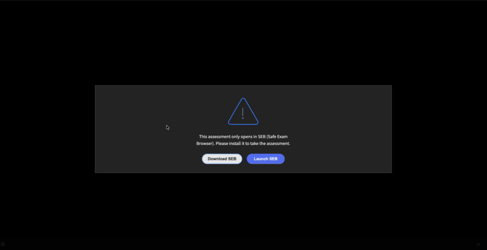

# 在安全考试浏览器中启动测验

安全考试浏览器(SEB)是一种安全浏览器，旨在为在线评估提供受控环境。 Adobe Learning Manager支持安全考试浏览器，用于需要安全测试环境的测验。 当您选择需要安全考试浏览器的测验时，Adobe Learning Manager会提示您下载或启动安全考试浏览器，然后才能访问测验。

安全考试浏览器为参加测验提供了受限制的环境。 安全考试浏览器启动后，对其他浏览器和应用程序的访问会受到限制，并且会断开活动呼叫。

仅选定测试需要“安全考试浏览器”，该浏览器不会影响其他课程模块，例如虚拟教室会话。

本文介绍了如何下载Safe Exam Browser、从Adobe Learning Manager启动它以及访问测验。

**下载安全考试浏览器**

如果您的设备尚未安装“安全考试浏览器”，请按照以下步骤下载并安装它：

1. 打开课程并选择需要“安全考试浏览器”的自学考试。
1. 选择&#x200B;**下载SEB**。 将打开“Safe Exam Browser（安全考试浏览器）”下载页面。

   

1. 为您的设备下载并安装适当版本的“安全考试浏览器”。
1. 安装完成后，请返回Adobe Learning Manager中的测验。

## 启动Safe Exam浏览器

安装“安全考试浏览器”后，启动应用程序以访问测验。

1. 打开课程并选择需要“安全考试浏览器”的自学考试。
1. 选择&#x200B;**启动SEB**。
1. 出现提示时，允许所需的系统权限。
“安全考试浏览器”启动并打开选定的测验。
1. 访问测验并在安全考试浏览器中完成考试。
   >[!NOTE]
   >
   > 当您通过安全考试浏览器(SEB)登录Adobe Learning Manager时，您只能访问分配的、未尝试且需要SEB的测验。 您无法访问其他学习内容。
1. 选择&#x200B;**退出SEB**。
您将被重定向到为您的帐户配置的页面。
