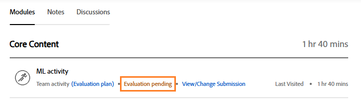

# 在Adobe Learning Manager中以团队的形式提交作业

查看您的团队，一起处理任务，为整个团队上传一个文件，并查看您团队的评估结果。

将您分配到团队后，您会收到通知。

在基于团队的文件提交模块中，任何团队成员都可以为其上传同一团队中每个人的文件。 您的讲师对作品进行一次评估，评估结果适用于整个团队。

## 查看您的团队和评估计划

1. 在“学习者”应用程序中打开课程，然后转到课程概述页面。 团队活动在课程大纲中标记为团队活动。

   

1. 选择&#x200B;**查看团队成员**&#x200B;以查看与您位于同一团队的其他学习者列表。

   

1. 如果您尚未加入团队，则会出现一条消息，告诉您在分配到团队后开始活动。 请联系您的讲师或管理员。

1. 如果作者允许，请查看评估的内容。 可以读取评估计划说明和每个评估参数的说明。 您无法查看答案选项、点数或权重。

将您添加到团队、从团队中删除，或者添加或删除团队成员时，您会收到通知和电子邮件。

## 提交团队的文件

1. 在“课程概述”页面上，打开基于团队的活动。

1. 同意您的团队提交文件。 选择&#x200B;**上传**。

   

1. 上传文件。 状态更改为&#x200B;**评估挂起**。 但是，您可以查看您提交的内容并提交其他文件。

   

将通知您的讲师。 每个团队成员都可以查看状态和提交的文件，并可下载该文件。 当任何成员提交或重新提交时，所有团队成员都会收到通知和电子邮件。

要在批准文件之前替换文件，请选择&#x200B;**查看**/**更改提交**，然后上传新文件。

>[!NOTE]
>
>如果作者不需要审阅者批准，则提交文件后，每个团队成员的活动都会立即完成。

## 查看结果

1. 在讲师评估基于团队的活动后将其打开。 所有团队成员都会收到通知。

1. 查看状态，例如已批准或已拒绝。

1. 阅读讲师的评论（如果讲师选择显示）。

1. 如果活动有评估计划，请查看审阅者的姓名、每个评估参数的选定选项、书面答复以及任何备注。 不显示单个选项的点数。

1. 如果打分，请查看您团队的整体分数。

如果活动不需要审批，您会看到它已经过评估，并会显示结果。

## 拒绝后重新提交

如果团队提交的内容被拒绝，请阅读注释，然后上传新文件。 您的新文件将替换以前的文件。

## 故障排除

**该活动表示您必须被分配到团队。** 您尚未加入团队。 请联系您的讲师。

**无法切换到另一个实例。** 在团队提交后，您无法切换实例。 仅当您的团队处于解锁状态时，才允许切换。

**提交内容消失，状态显示待提交。** 您的讲师已取消提交，您收到了通知和电子邮件。 再次上传文件。 您看不到之前提交的内容或评论。
